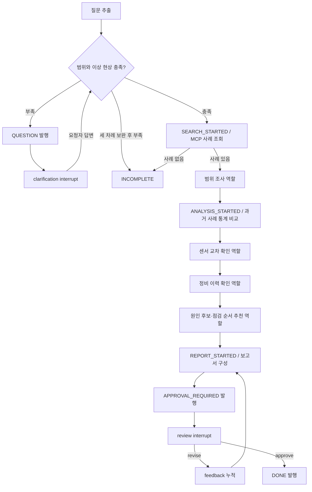

# TRACE v1.0.0 에이전트

유일한 조사 그래프는 `agent/graph.py`의 `build_graph()`다. backend는 공개 API·권한·저장·이벤트를 소유하고 그래프를 내부 HTTP로 실행·재개한다. `backend/graph.py`와 삭제된 CLI 그래프는 v1 실행 경로가 아니다.

## 실제 흐름



`agent/query.py`는 한·영 규칙으로 장비·챔버·레시피·제품·증상·계측값을 추출하고 추가 답변을 병합한다. 접수에는 이상 현상과 조사 범위 중 하나가 필요하다. 계측값을 제공하지 않았다고 값을 만들어내지 않는다. 세 차례 보완 뒤에도 조건이 부족하거나 사례가 없으면 승인 기록 없이 INCOMPLETE로 끝난다.

분류·배정·장비/공정별 서브그래프와 LLM 도구 선택 루프는 없다. 검토 권한은 backend가 검사하며 agent가 사용자를 인증하지 않는다.

## 전문 조사 노드

하나의 체크포인트 Supervisor가 다섯 독립 조사 에이전트 그래프를 순서대로 실행한다.

| 노드 | 책임 | 현재 근거와 한계 |
|---|---|---|
| 범위 조사 | 질문에서 추출한 범위와 Business MCP 데모 사례 및 권한 필터된 승인 조사 이력 확인 | 승인 이력 조회는 원 요청자의 저장 신원을 전달하고 MCP/Backend가 worker 소유권을 강제한다. MES Lot/Wafer와 Run 목록은 미연결 |
| 과거 Run 비교 | 입력 계측값을 유사 사례 기준 통계와 결정론적으로 비교 | 동일 Recipe·Step의 실측 Run 시계열은 미연결 |
| 센서 교차 확인 | 사용자 입력 계측값과 추가 센서 필요 항목을 구분 | Gas Flow·펌프·밸브 등 원본 센서 시계열·태그는 미연결 |
| 정비 이력 확인 | 정비 이력 조회 여부와 미확인 범위를 보고 | 현재 MCP 서버에 정비 이력 도구가 없어 데이터를 조회하지 않음 |
| 후보·점검 순서 | 사례 가설과 RAG MCP가 반환한 SOP 조항을 연결해 제시 | 문서 검색 결과는 실제 장비 데이터가 아니며 원인 확정·정비 조치가 아님 |

각 역할은 `agent/agents/` 아래의 **서로 다른 컴파일된 LangGraph 하위 그래프 5개**다. 상위 `agent/graph.py`는 이 하위 그래프들을 Supervisor처럼 순서대로 실행하고 기존 작업 체크포인트·재질문·승인 흐름을 소유한다. 결과는 보고서 `stages`에 한 에이전트당 한 건씩 기록되며, 화면도 다섯 에이전트를 각각 표시한다.

각 에이전트 그래프는 `common.py`의 근거 수집 단계와 역할별 추론 단계를 가진다. 루트 `.env`에 `OPENAI_API_KEY`와 `OPENAI_MODEL`이 모두 있으면 에이전트마다 OpenAI 구조화 응답 호출을 한 번 시도한다. 키가 없거나 호출에 실패하면 같은 하위 그래프가 규칙 기반 결과를 내며, 화면에 `규칙 기반 실행`으로 표시한다. 별도로 SOP 자연어 검색 MCP는 `OPENAI_API_KEY`를 사용해 질문 임베딩과 재순위화를 실행하므로 키가 없으면 해당 MCP 실패를 미확인으로 보고하며 가짜 체크리스트로 대체하지 않는다.

추천 에이전트는 기존 RAG MCP의 `search_documents(document_ids)`와 새 `search_sop(query)`를 모두 호출한다. 첫 번째는 기존 `etch_documents`에서 사례가 연결한 ID를 정확 조회하고, 두 번째는 기존 `sop_chunks.py`·`sop_vectors.py`·`sop_rerank.py` 구현으로 SOP/WI/SPEC 문서를 청크화·임베딩·20개 후보 회수·3개 조항 재순위화한다. `search_sop`은 별도 `sop-postgres` 볼륨에 문서 색인을 idempotent하게 적재하고, query embedding 및 `gpt-4.1-mini` 재순위화를 실행한다. 센서와 정비 에이전트에는 아직 전용 MCP/API가 없어 확인 불가로 기록한다. 점검 순서는 하드코딩하지 않으며, MCP가 실제 반환한 조항 원문과 ID만 보고서에 넣는다.

## 근거와 숫자

`agent/evidence.py`의 MCP 어댑터가 다음 도구를 호출한다.

| 서버 | 도구 | 책임 |
|---|---|---|
| business MCP | `search_cases(context)` | backend 내부 API의 샘플 사례를 점수화·검색 |
| business MCP | `analyze_metrics(cases,metrics)` | 결정론적 평균·표준편차·편차율·z-score 및 근거 ID |
| business MCP | `list_investigations(user_name,user_role)` | Backend가 권한 필터한 승인 이력 목록; 에이전트가 같은 장비·Chamber·Recipe/증상 이력 최대 3건을 선택 |
| business MCP | `save_investigation(task_id,command_id,event_id,payload)` | 승인된 최종 보고서를 Backend 검증 후 저장; LangGraph DONE callback에서 호출 |
| rag MCP | `search_documents(document_ids)` | PostgreSQL 샘플 문서의 정확한 조항 ID 조회 |
| rag MCP | `search_sop(query)` | SOP/WI/SPEC 색인에서 임베딩 후보 20개 검색 후 기존 reranker로 3개 조항 반환 |

agent는 업무 테이블을 직접 읽지 않는다. PostgreSQL 연결은 자신의 체크포인트에 사용한다. RAG MCP만 전용 SOP pgvector 저장소를 사용한다. 최초 `search_sop` 호출은 문서 색인을 적재하므로 처음에는 임베딩 비용이 발생하고, 이후 문서가 바뀌지 않으면 재임베딩하지 않는다. 이후 조사마다 query embedding과 재순위화 모델 호출이 발생한다. 기존 ID 조회와 SOP 자연어 검색은 서로 다른 출처이며 같은 ID면 의미 검색으로 반환된 SOP 조항을 표시한다. 이력은 최초 요청자의 DB 저장 신원으로 조회하고 MCP/Backend의 기존 worker 소유권·engineer/admin 전체 조회 규칙을 따른다. 과거 승인 이력은 참고 자료일 뿐 현재 원인 확정이 아니다. 센서/정비 MCP는 아직 없다.

보고서는 `context`, `scored`, `metrics`, `causeCases`, `docIds`, `documents`, `history`, `stages`, `checks`, `summary`, `unknowns`, `feedback`, `demo:true`를 갖는다. `checks`는 RAG MCP가 실제 반환한 세 조항의 제목·원문·ID이며 UI에서 관련도 순서로 제시한다. 상위 비정상 원인 사례 최대 3개의 문서 ID를 연결한다. 사례·문서 MCP가 반환한 `is_demo`, `source`, 단위, 개정, 검색 거리와 근거 ID 메타데이터를 보존한다. 이력 근거는 최대 3건만 보고서에 포함한다. 과거 보고서에서 저장된 `provisional_sop` 체크는 읽기 호환성만 유지하며 신규 조사에는 생성하지 않는다.

## 실행

프로젝트 루트에서 `.env`의 `OPENAI_API_KEY`를 설정한 뒤 다음 명령으로 서비스를 다시 빌드·실행한다.

```sh
docker compose -f compose.yaml up -d --build
```

Compose가 기본 서비스 DB와 분리된 `sop-postgres` DB를 띄우며, SOP 문서 폴더를 RAG MCP에 읽기 전용으로 연결한다. 첫 `search_sop` 호출 때 문서 청크를 별도 pgvector 볼륨에 색인한다. 첫 색인에는 문서 임베딩 토큰이 사용되고, 문서 내용이 바뀌지 않으면 재임베딩은 생략한다. 이후 조사마다 질문 임베딩과 재순위화 API를 호출한다. 키가 없거나 검색 서비스·DB 호출이 실패하면 보고서의 미확인 사유에 실패를 적고, 하드코딩된 점검 목록을 대신 만들지 않는다. Agent의 역할별 자연어 분석은 별도 `OPENAI_MODEL`을 설정했을 때만 호출한다.

## 보고서와 수정

Agent의 역할별 문구 분석은 `OPENAI_API_KEY`와 `OPENAI_MODEL`이 모두 있을 때만 호출한다. 수치 계산·근거 검색 결과·원인 사실을 모델이 생성하지 않는다. 두 설정이 없어도 사례/통계/정확-ID MCP는 사용할 수 있지만, 자연어 SOP RAG에는 `OPENAI_API_KEY`가 필수다. 루트 `.env`의 키는 Compose가 Agent와 RAG MCP 양쪽으로 전달한다.

`revise`는 검토 의견을 feedback에 누적하고 기존 사례·수치·문서를 유지한 채 보고서를 다시 만든다. 템플릿은 수정 요청을 기록하며 자유 문장 편집을 자동 수행했다고 주장하지 않는다. 다시 APPROVAL_REQUIRED를 발행하고 검토를 기다린다. `approve`면 DONE을 발행한다. 승인 스냅샷 저장은 backend의 책임이다.

## 중단·재개와 이벤트

- task UUID가 PostgreSQL 체크포인트의 thread ID다.
- 이벤트 발행 노드와 interrupt 노드를 분리한다. 재질문·수정 버전별 안정된 event ID로 재실행 중복을 식별한다.
- 재질문은 `{resume:{text}}`, 검토는 `{resume:{action,comment,by}}`로 같은 thread를 재개한다.
- agent는 task별 lock을 갖고 단일 worker에서 호출을 직렬화한다. 체크포인트가 이미 있는 작업의 초기화와 대기 종류가 맞지 않는 resume은 409다.
- backend는 실행 요청의 `X-Command-ID`를 지정한다. agent는 현재 명령 ID를 config에 넣어 이벤트 콜백으로 전달한다. backend는 명령 ID와 조건부 상태 변경으로 검토 경쟁·지연 콜백을 통제한다. agent HTTP 전달·콜백 실패를 성공으로 숨기지 않는다.
- backend 재시작 시 WAITING_INPUT/WAITING_APPROVAL은 보존하고 중단된 QUEUED/RUNNING은 FAILED로 표시한다.

## 커버리지와 후속 범위

`agent/tests/test_query.py`는 추출·병합, `test_graph.py`는 재질문·보고서·수정·승인·정보/사례 부족·콜백 재실행을 검증한다. `test_checkpoint.py`는 `AGENT_TEST_DATABASE_URL`이 있을 때 실제 PostgreSQL과 별도 프로세스로 대기·수정·승인 재시작을 검증한다. `backend/tests/`는 HTTP 권한·승인 스냅샷·경쟁·이벤트/SSE·실패 처리를 다룬다. 이는 테스트 코드의 범위이며 이번 문서 변경에서 통과를 확인했다는 뜻이 아니다.

CLI 전용 Markdown 출력·입력 루프·답변 후 선택적 기록 제안은 폐기했다. Keycloak과 승인된 조사 이력의 근거 검색은 후속 범위다. 현재 승인 이력 조회를 검색 도구로 오해하지 않는다.
