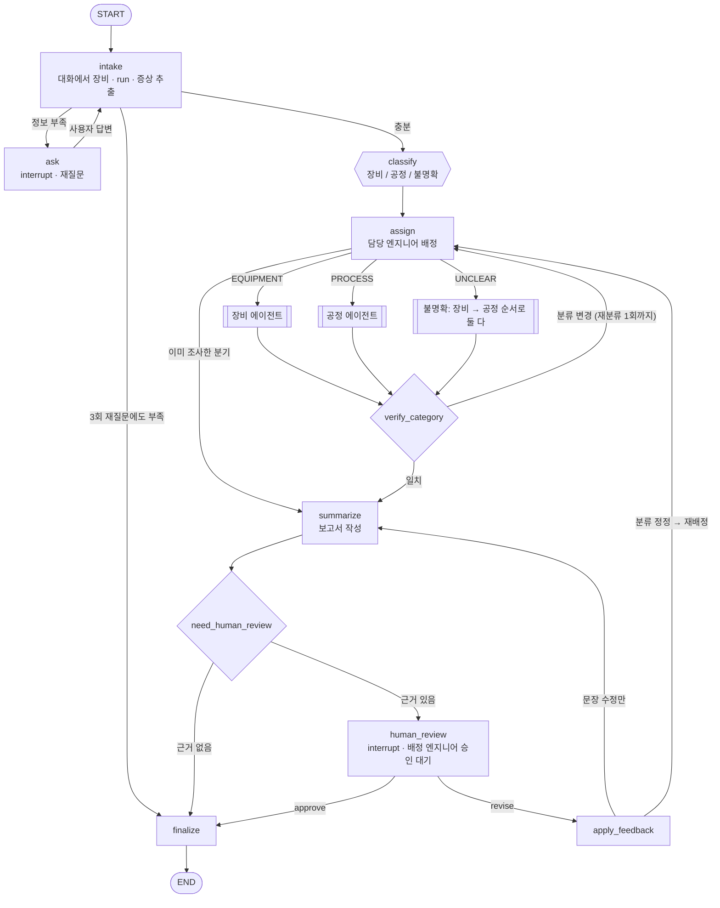
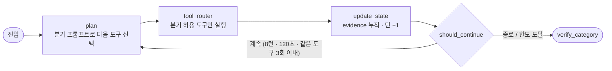
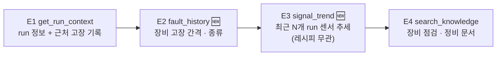
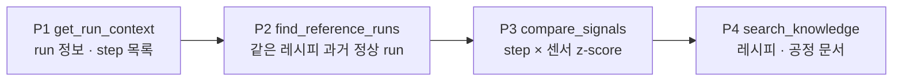
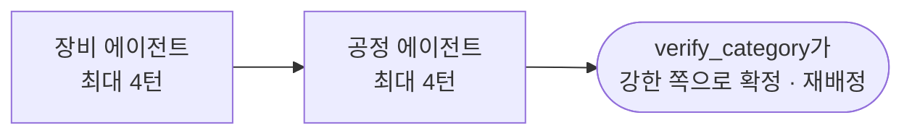
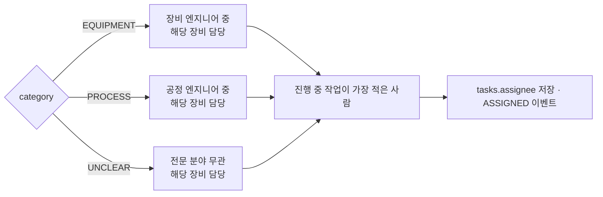

# 에이전트 설계 (LangGraph)

원칙: **숫자는 도구(코드)가 계산하고, LLM은 정보 추출·분류 판단·도구 선택·문장 작성만 한다.** 원인을 단정하지 않으며, 저장은 **배정된 엔지니어**의 승인 후에만 한다.

## 1. 메인 그래프



| 노드 | 하는 일 | 출력 / 이벤트 |
|---|---|---|
| `intake` | 대화 전체에서 장비(`01M01`), run_id(`숫자-숫자`), 증상을 추출. run이 DB에 있는지 확인. 장비가 빠졌어도 run_id로 장비가 하나로 정해지면 채움 | `tool`, `run_id`, `symptom` |
| `ask` | 빠진 항목을 묻고 `interrupt()`로 정지 → 사용자가 답하면 같은 thread로 재개 | `QUESTION` 이벤트, 상태 `WAITING_INPUT` |
| `classify` | 엔지니어가 정정한 분류가 있으면 그대로. 아니면 대화 + run 정보 + 근처 고장 기록으로 LLM 판정. confidence < 0.6 → `UNCLEAR` | `CLASSIFIED` 이벤트 |
| `assign` | 분류에 맞는 엔지니어 배정 (3장). 이미 조사한 분기면 조사를 건너뛰고 보고서로 | `ASSIGNED` 이벤트 |
| 분기 에이전트 | 2장의 서브그래프 | `evidence[]` |
| `verify_category` | 근거와 분류가 맞는지 코드 규칙으로 확인 (아래 표). 바뀌면 재배정 | `CLASSIFIED(reroute)` |
| `summarize` | 구조화 보고서. 분류·근거·담당자를 첫 항목에 | `TOKEN` |
| `human_review` | `interrupt()` — 배정 엔지니어만 결정 가능 | `APPROVAL_REQUIRED` |
| `finalize` | 승인 시에만 `save_investigation` | `DONE` |

**verify_category 규칙**

| 현재 분류 | 반대 근거 → 분류 변경 |
|---|---|
| PROCESS | 같은 센서가 **레시피와 무관하게** 최근 run들에서 추세 이탈 (`signal_trend`), 또는 run 종료 후 24h 내 FlowCool 고장 → EQUIPMENT |
| EQUIPMENT | 추세는 평탄하고, 편차가 **특정 레시피·step에서만** 나타남 (`compare_signals`) → PROCESS |
| UNCLEAR | 두 분기를 다 돌았으므로 강한 쪽으로 확정 (재조사 없이 재배정만). 둘 다 약하면 UNCLEAR 유지 |

## 2. 분기별 서브그래프

세 분기 모두 **같은 루프 구조**를 쓰고, 분기마다 **프롬프트와 허용 도구만 다르다.**



LLM이 실패하면 아래 **기본 단계 순서**대로 고정 실행한다 (Recovery). 정상일 때도 LLM은 보통 이 순서를 따르고, 결과에 따라 단계를 건너뛰거나 인자를 바꿔 재시도한다.

### 2.1 장비 에이전트 — "장비 상태가 나빠지고 있는가?"



- 주요 센서: `FLOWCOOLPRESSURE`, `FLOWCOOLFLOWRATE`, `IONGAUGEPRESSURE`
- 보고서 다음 조치: FlowCool 점검 순서, 최근 정비 이력 확인
- 프롬프트: `prompts/plan_equipment.md`

### 2.2 공정 에이전트 — "이 레시피·step 조건이 정상 범위를 벗어났는가?"



- 주요 센서: `ETCHBEAMVOLTAGE`, `ETCHBEAMCURRENT`, `ETCHSUPPRESSOR*`, `ETCHGASCHANNEL1READBACK`, `ACTUALSTEPDURATION`
- 보고서 다음 조치: 레시피 파라미터·step 시간 확인, 직전 레시피 변경 이력 확인
- 프롬프트: `prompts/plan_process.md` (기존 `plan.md`)

### 2.3 불명확 — 둘 다, 예산 절반씩



## 3. 담당 엔지니어 배정과 접근 범위

### 배정 규칙



- 엔지니어 정보는 `engineers` 테이블 🆕: `name`, `specialty`(`EQUIPMENT` · `PROCESS`), `tools[]`(담당 장비).
- 진행 중 작업 = 상태가 `DONE`·`FAILED`가 아닌 작업.
- **재배정**은 분류가 바뀔 때만 일어난다 (verify_category 재분류, 또는 엔지니어의 분류 정정). 이전 담당자는 그때부터 그 작업을 볼 수 없다. 단 `REVIEWED` 등 이력은 그대로 남는다.
- 담당 가능한 엔지니어가 없으면 `assignee = null` → 관리자 화면 "미배정"에 뜨고, 관리자가 배정한다.

### 누가 무엇을 보나

| 역할 | 목록 · 상세 · SSE | 승인 / 수정 요청 | 답변(재질문) |
|---|---|---|---|
| 작업자 | 본인이 요청한 작업 | X | 본인 작업 |
| 엔지니어 | **본인에게 배정된 작업** (+ 본인이 요청한 작업) | **배정된 작업만** | 본인이 요청한 작업 |
| 관리자 | 전체 | X (배정 변경만) | X |

배정 전(분류 중)에는 엔지니어에게 보이지 않는다. 보고서 원문(`report`)도 같은 규칙으로 막힌다. 권한 검사는 API에서 하고, 그래프는 관여하지 않는다.

## 4. State

| 필드 | 설명 |
|---|---|
| `task_id` | = LangGraph thread_id |
| `messages[]` 🆕 | 사용자 대화 (첫 질문 + 재질문 답변) |
| `tool`, `run_id`, `symptom` 🆕 | intake 추출 결과 |
| `asks` 🆕 | 재질문 횟수 (최대 3) |
| `category`, `confidence`, `category_reason` 🆕 | 분류 결과 |
| `forced_category` 🆕 | 엔지니어가 정정한 분류 |
| `assignee` 🆕 | 담당 엔지니어 |
| `investigated[]`, `reroutes` 🆕 | 조사 완료한 분기, 재분류 횟수 (최대 1) |
| `branch`, `branch_turns` 🆕 | 현재 분기와 분기 내 턴 |
| `next_call`, `last_result` | 루프 내부 |
| `evidence[]` | 도구 결과 누적 (`{name, args, result, ok}`) |
| `turns`, `started_at` | 한도 관리 |
| `report`, `feedback[]`, `approval`, `saved` | 보고서와 검토 |

## 5. 도구

| 도구 | 분기 | 계산 |
|---|---|---|
| `get_run_context` | 공통 | run 정보, step 목록, run 종료 이전 고장만 (미래 누설 차단) |
| `search_knowledge` | 공통 | pgvector 코사인 검색 |
| `fault_history` 🆕 | 장비 | 장비 고장 목록, 고장 간격, run 직후 72h 내 신고 고장 |
| `signal_trend` 🆕 | 장비 | 대상까지 최근 N개 run(레시피 무관, 레시피 평균 보정) 센서 추세 → drift z |
| `find_reference_runs` | 공정 | 같은 레시피, 대상 이전, 고장 직전 24h 제외 |
| `compare_signals` | 공정 | step × 센서 z-score, \|z\| ≥ 3 표시 |
| `save_investigation` | — | LLM 호출 불가. `finalize`에서 승인 후에만 |

## 6. 보고서 형식

```json
{
  "category": "EQUIPMENT",
  "category_reason": "run 종료 14분 뒤 FlowCool 고장 기록, 사용자가 압력 알람을 신고",
  "assignee": "이장비",
  "summary": "…",
  "facts": ["…"],
  "evidence": ["investigation_guide.md > FlowCool 점검 순서"],
  "next_actions": ["…"],
  "unknowns": ["센서값은 표준화되어 단위 없음"]
}
```

## 7. Harness (안전장치)

| 항목 | 값 |
|---|---|
| 재질문 | 3회 (넘으면 정보 부족으로 종료, 저장 안 함) |
| 턴 한도 | 8 (불명확은 분기당 4) |
| 시간 한도 | 120초 (사용자·엔지니어 대기 시간 제외) |
| 같은 도구 | 3회 |
| 재분류 | 1회 (엔지니어 정정은 별도) |
| LLM 재시도 | 2회 → 대체 모델 `gpt-4.1-mini` → 고정 순서 + 템플릿 보고서 |
| 도구 결과 | 3,000자에서 자름 |
| 저장 | 배정 엔지니어 승인 후에만, `task_id` 중복 저장 차단 |
