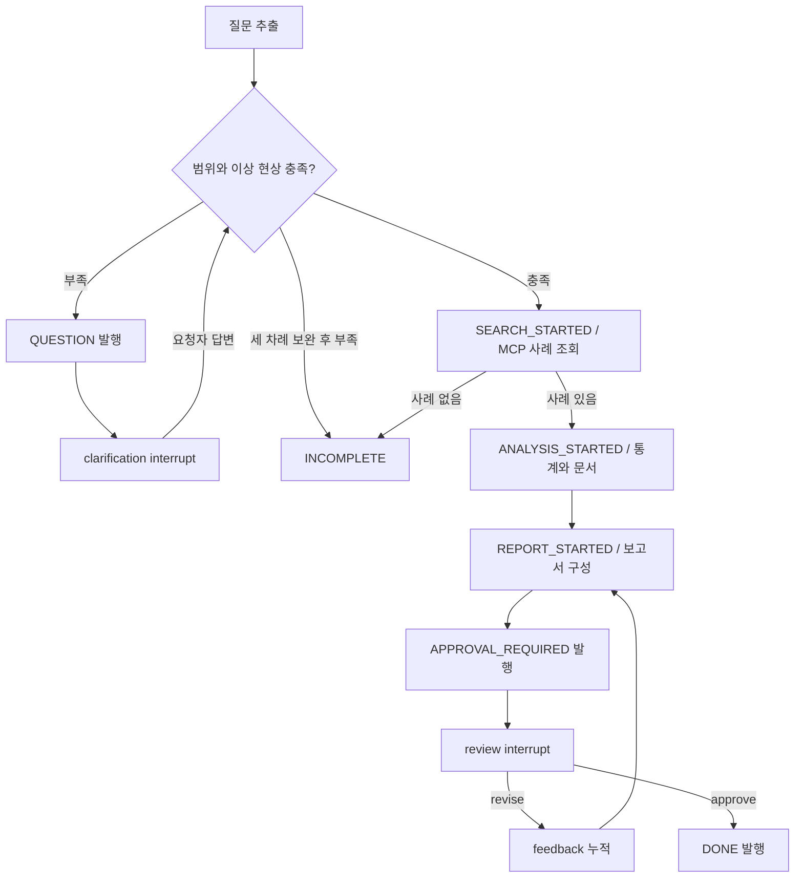

# TRACE v1.0.0 에이전트

유일한 조사 그래프는 `agent/graph.py`의 `build_graph()`다. backend는 공개 API·권한·저장·이벤트를 소유하고 그래프를 내부 HTTP로 실행·재개한다. `backend/graph.py`와 삭제된 CLI 그래프는 v1 실행 경로가 아니다.

## 실제 흐름

`agent/query.py`는 한·영 규칙으로 장비·챔버·레시피·제품·증상·계측값을 추출하고 추가 답변을 병합한다. 접수에는 이상 현상과 조사 범위 중 하나가 필요하다. 계측값을 제공하지 않았다고 값을 만들어내지 않는다. 세 차례 보완 뒤에도 조건이 부족하거나 사례가 없으면 승인 기록 없이 INCOMPLETE로 끝난다.

분류·배정·장비/공정별 서브그래프와 LLM 도구 선택 루프는 없다. 검토 권한은 backend가 검사하며 agent가 사용자를 인증하지 않는다.

## 근거와 숫자

`agent/evidence.py`의 MCP 어댑터가 다음 도구를 호출한다.

| 서버 | 도구 | 책임 |
|---|---|---|
| business MCP | `search_cases(context)` | backend 내부 API의 샘플 사례를 점수화·검색 |
| business MCP | `analyze_metrics(cases,metrics)` | 결정론적 평균·표준편차·편차율·z-score 및 근거 ID |
| rag MCP | `search_documents(document_ids)` | PostgreSQL 샘플 문서의 정확한 조항 ID 조회 |

agent는 업무 테이블을 직접 읽지 않는다. PostgreSQL 연결은 자신의 체크포인트에 사용한다. 문서 검색은 임베딩·벡터 검색이 아니다. 근거 데이터는 `db/`의 시연용 사례·문서이며 PHM 실측 데이터나 승인된 조사 기록 검색 결과가 아니다.

보고서는 `context`, `scored`, `metrics`, `causeCases`, `docIds`, `documents`, `summary`, `unknowns`, `feedback`, `demo:true`를 갖는다. 상위 비정상 원인 사례 최대 3개의 문서 ID를 연결한다. 문서를 찾지 못하면 누락을 명시한다. 수치에는 원래 단위와 근거 사례 ID를 보존한다.

## 보고서와 수정

기본은 키 없이 실행 가능한 템플릿이다. `agent/prose.py`는 agent 프로세스에 `OPENAI_API_KEY`와 `OPENAI_MODEL`이 모두 있을 때만 제한된 불확실성 문구 선택을 시도한다. 수치 계산·근거·원인을 모델이 생성하지 않는다. 설정이 없거나 선택이 실패하면 템플릿을 사용한다. 루트 `.env`만으로 agent 컨테이너에 선택 설정이 전달되는 것은 아니므로 실제 `compose.yaml` 환경을 확인한다.

`revise`는 검토 의견을 feedback에 누적하고 기존 사례·수치·문서를 유지한 채 보고서를 다시 만든다. 템플릿은 수정 요청을 기록하며 자유 문장 편집을 자동 수행했다고 주장하지 않는다. 다시 APPROVAL_REQUIRED를 발행하고 검토를 기다린다. `approve`면 DONE을 발행한다. 승인 스냅샷 저장은 backend의 책임이다.

## 중단·재개와 이벤트

- task UUID가 PostgreSQL 체크포인트의 thread ID다.
- 이벤트 발행 노드와 interrupt 노드를 분리한다. 재질문·수정 버전별 안정된 event ID로 재실행 중복을 식별한다.
- 재질문은 `{resume:{text}}`, 검토는 `{resume:{action,comment,by}}`로 같은 thread를 재개한다.
- agent는 task별 lock을 갖고 단일 worker에서 호출을 직렬화한다. 체크포인트가 이미 있는 작업의 초기화와 대기 종류가 맞지 않는 resume은 409다.
- backend는 실행 요청의 `X-Command-ID`를 지정한다. agent는 현재 명령 ID를 config에 넣어 이벤트 콜백으로 전달한다. backend는 명령 ID와 조건부 상태 변경으로 검토 경쟁·지연 콜백을 통제한다. agent HTTP 전달·콜백 실패를 성공으로 숨기지 않는다.
- backend 재시작 시 WAITING_INPUT/WAITING_APPROVAL은 보존하고 중단된 QUEUED/RUNNING은 FAILED로 표시한다.

## 커버리지와 후속 범위

`agent/tests/test_query.py`는 추출·병합, `test_graph.py`는 재질문·보고서·수정·승인·정보/사례 부족·콜백 재실행을 검증한다. `test_checkpoint.py`는 `AGENT_TEST_DATABASE_URL`이 있을 때 실제 PostgreSQL과 별도 프로세스로 대기·수정·승인 재시작을 검증한다. `backend/tests/`는 HTTP 권한·승인 스냅샷·경쟁·이벤트/SSE·실패 처리를 다룬다. 이는 테스트 코드의 범위이며 이번 문서 변경에서 통과를 확인했다는 뜻이 아니다.

CLI 전용 Markdown 출력·입력 루프·답변 후 선택적 기록 제안은 폐기했다. 사용자 로그인은 Keycloak과 backend가 담당하고 agent 내부 인증은 공유 키로 유지한다. 승인된 조사 이력의 근거 검색은 후속 범위다. 현재 승인 이력 조회를 검색 도구로 오해하지 않는다.
