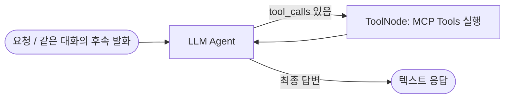

# TRACE Agent

Agent는 LangGraph에 구성한 단일 ReAct 에이전트다. Backend가 요청할 때 작업 ID를 대화 ID로 사용하고, 이후 같은 ID로 들어오는 사용자 발화를 PostgreSQL 체크포인트의 같은 메시지 이력에 더한다. 화면 레이아웃이나 프론트엔드 단계 상태를 출력 계약으로 삼지 않는다. Agent HTTP 응답의 `response`는 사용자에게 보여줄 자연어 텍스트다.

## 그래프 구조



구현은 참고 저장소 [langchain-ai/react-agent](https://github.com/langchain-ai/react-agent)의 명시적 ReAct 패턴을 따른다. 모델 노드가 `AIMessage.tool_calls`를 내면 LangGraph의 `ToolNode`가 도구를 실행하고, 도구 결과를 `ToolMessage`로 메시지에 추가해 다시 모델 노드로 보낸다. 도구 호출이 끝나고 모델이 최종 답을 내면 그래프가 종료된다. 기존 코드는 한 LangGraph 노드 내부의 수동 HTTP 반복문이었으나, 이를 실제 `agent`↔`tools` 순환 그래프로 교체했다. Tool 목록과 각 description은 `agent/tools.py`에서 명시적으로 관리한다.

## 사용 가능한 Tools

`agent/tools.py`의 `TOOL_NAMES`와 `build_tools()`가 현재 Tools의 단일 목록이다.

- `search_cases`: Business MCP에서 장비·챔버·레시피·증상·계측 조건에 맞는 사례 검색
- `analyze_metrics`: 사례 기준으로 계측값의 평균·표준편차·편차율·z-score 비교
- `search_documents`: 사례가 반환한 문서 ID를 RAG MCP에서 정확 조회
- `search_sop`: RAG MCP에서 SOP/WI/SPEC/OCAP 의미 검색
- `evaluate_etch_physics`: Physics MCP의 식각 깊이, 평균 식각 속도, 선택비 관계식 계산
- `list_investigations`: 요청자 정보가 있을 때 승인 조사 이력 조회
- `record_selection`: 명시적 승인 발화에 대해 후보 ID·원인·조치가 일치하는지 확인하고 대화 체크포인트에 도구 결과를 남김

모델은 대화 맥락을 읽고 필요한 Tool을 선택하거나 여러 Tool을 순서대로 호출한다. 모든 요청에 모든 MCP를 억지로 호출하지 않는다. Physics MCP는 결정론적 계산 도구다. 입력이 없는 물리량을 만들어 내지 않으며, 온도나 압력의 원인을 시뮬레이션한다고 설명하지 않는다. 확정할 수 없는 후보는 근거의 한계와 구별에 필요한 점검을 설명한다.

## 요청과 대화 메모리

요청은 `POST /internal/tasks/{task_id}/run`으로 보낸다. 새 대화에는 `role=user` 질문 또는 Backend가 만든 `role=system` 경보 텍스트를 보낸다. 모든 후속 발화는 같은 `task_id`를 사용한다. 이 값은 LangGraph checkpointer의 `thread_id`다. Backend 호환을 위해 `{question}` 시작 본문과 `{resume:{text}}`/검토 본문도 받고, Agent 내부에서는 이를 같은 사용자 메시지 형태로 변환한다.

`role=system` 경보는 `agent/alert_text.py`에서 정규식 없이 고정 헤더·행 구분으로 구조화한다. 원문 경보와 파싱 JSON이 함께 모델 입력에 들어가며, 경보 텍스트를 system prompt로 승격하지 않는다. 자연어 사용자 질문은 별도 정규식/규칙 기반 의도 분류기를 거치지 않는다. 하나의 LLM이 대화 이력을 읽고 재조사, 조치만 재조사, 승인, 일반 질문 의도를 판단한다.

## 로컬 실행과 텍스트 시험

프로젝트 루트의 `.env`에 `OPENAI_API_KEY`, `OPENAI_MODEL`, `INTERNAL_API_KEY`를 설정한 뒤 서비스를 시작한다.

```sh
cp .env.example .env
docker compose -f compose.yaml up -d --build backend agent business-mcp rag-mcp physics-mcp
```

프론트엔드 없이 Agent 컨테이너에서 대화형 텍스트 클라이언트를 실행한다. 첫 메시지를 경보로 시작하려면 `--role system`을 준다. 스크립트가 대화 ID 하나를 발급하고 모든 후속 문장을 동일 ID로 보내며, 화면 JSON이 아니라 Agent의 답변 텍스트만 출력한다.

```sh
docker compose exec agent python -m agent.dev_chat
# 또는 경보 텍스트로 시작
docker compose exec agent python -m agent.dev_chat --role system
```

대화 중에는 한 줄씩 질문하면 된다. 종료는 `/exit`다. 실행 결과를 재현할 때는 `--task-id <UUID>`를 지정해 해당 대화 ID를 다시 사용할 수 있다. 새 대화를 시작할 때는 다른 ID를 쓴다. Agent URL은 Compose 내부 전용이므로 호스트 브라우저에서 직접 접근하지 않아도 된다.

Agent endpoint 자체를 자동 검증하려면 아래 테스트를 실행한다. 이 테스트는 API 키나 외부 모델을 요구하지 않고 실제 LangGraph tool-routing loop를 모의 LLM 응답으로 구동한다.

```sh
cd agent
uv sync --group dev
uv run pytest -q
uv run ruff check .
uv run basedpyright
```

## LangSmith 추적

`.env`에 `LANGSMITH_TRACING=true`, `LANGSMITH_API_KEY`, `LANGSMITH_PROJECT=etch-trace-dev`를 설정하고 Agent를 다시 빌드한다. LangSmith 프로젝트에서 각 대화 run의 모델 판단, Tool call, Tool 결과, 최종 답을 확인할 수 있다. LLM 요청 함수는 API key를 tracing input으로 넘기지 않는다. 다만 질문·경보·MCP 결과는 trace에 들어갈 수 있으므로 처음에는 합성 자료로 확인하고 민감한 fab 데이터를 보내기 전에 보관/접근 정책을 검토한다.

## 경계

Agent는 각 task ID의 대화와 체크포인트를 보유하며, Backend는 로그인·공개 권한·태스크 기록·이벤트·승인 이력의 소유자다. 현재 `backend/v1_dispatch.py`는 Agent HTTP 응답 본문을 읽고 버리므로, Agent endpoint가 반환하는 `response`는 위 텍스트 CLI로 확인할 수 있지만 Backend task/화면에는 아직 전달되지 않는다. 이를 연결하려면 Backend response 저장/전달 변경이 별도로 필요하다. Agent의 `record_selection`은 사용자가 선택한 세트를 대화에서 검증했다는 뜻이며, Backend의 승인 스냅샷/공식 이력 저장과 동일하지 않다. Agent 코드만 바꾼 것을 Backend 저장 계약 완료로 간주하지 않는다.
