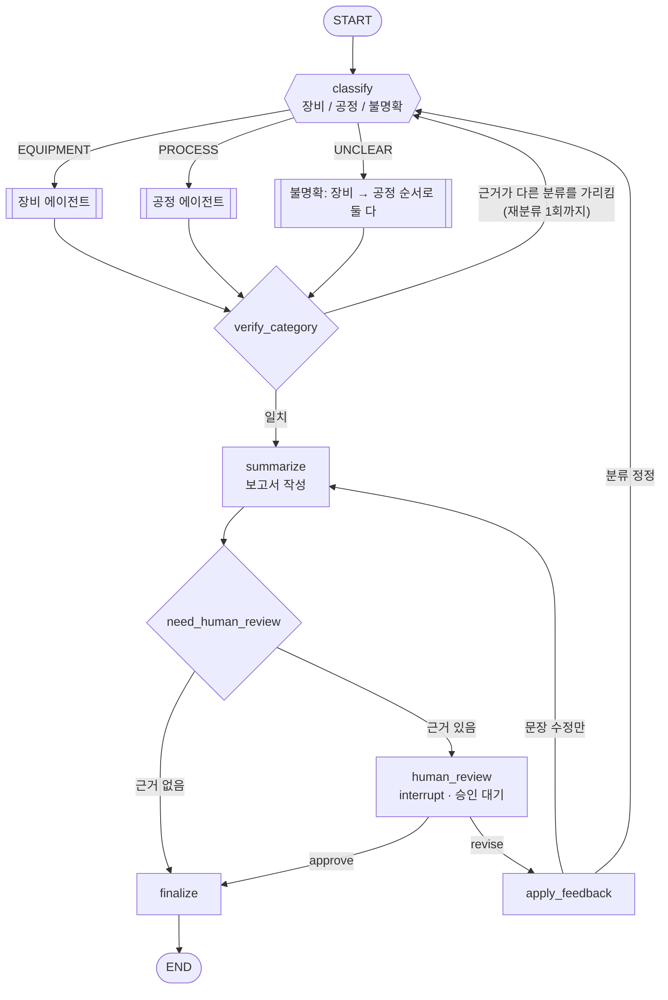
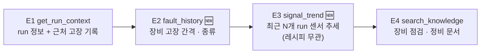
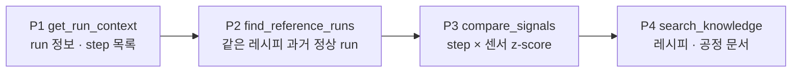
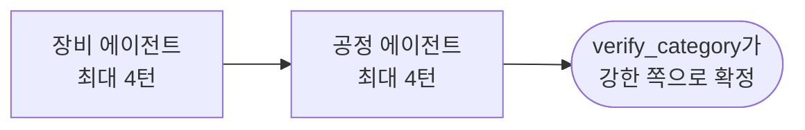

# 에이전트 설계 (LangGraph)

원칙: **숫자는 도구(코드)가 계산하고, LLM은 분류 판단·도구 선택·문장 작성만 한다.** 원인을 단정하지 않으며, 저장은 엔지니어 승인 후에만 한다.

## 1. 메인 그래프



| 노드 | 하는 일 | 출력 |
|---|---|---|
| `classify` | ① 엔지니어가 정정한 분류가 있으면 그대로 사용 ② 아니면 `get_run_context` 결과(근처 고장 기록) + 사용자 문장으로 LLM이 판정. confidence < 0.6 이면 `UNCLEAR` | `category`, `confidence`, `reason` → `CLASSIFIED` 이벤트 |
| 분기 에이전트 | 아래 2장의 서브그래프 | `evidence[]` |
| `verify_category` | 코드 규칙으로 근거와 분류가 맞는지 확인 (아래 표) | 일치 / 재분류 |
| `summarize` | 구조화 보고서. 분류와 그 근거를 첫 항목에 | `report` |
| `human_review` | `interrupt()` — 체크포인트 저장 후 정지 | 승인 / 수정 / 분류 정정 |
| `finalize` | 승인된 경우에만 `save_investigation` | `INV-xxxx` |

**verify_category 규칙**

| 현재 분류 | 반대 근거 (재분류 트리거) |
|---|---|
| PROCESS | 같은 센서가 **레시피와 무관하게** 최근 run들에서 추세 이탈 (`signal_trend`), 또는 run 종료 후 24h 내 FlowCool 고장 |
| EQUIPMENT | 추세는 평탄하고, 편차가 **특정 레시피·step에서만** 나타남 (`compare_signals`) |
| UNCLEAR | 양쪽 근거 중 강한 쪽으로 확정. 둘 다 약하면 UNCLEAR 유지하고 보고서에 명시 |

## 2. 분기별 서브그래프

세 분기 모두 **같은 루프 구조**를 쓰고, 분기마다 **프롬프트와 허용 도구만 다르다.**


LLM이 실패하면 아래 **기본 단계 순서**대로 고정 실행한다 (Recovery). 정상일 때도 LLM은 보통 이 순서를 따르고, 결과에 따라 단계를 건너뛰거나 인자를 바꿔 재시도한다.

### 2.1 장비 에이전트 — "장비 상태가 나빠지고 있는가?"



- 주요 센서: `FLOWCOOLPRESSURE`, `FLOWCOOLFLOWRATE`, `IONGAUGEPRESSURE`
- 보고서 다음 조치: FlowCool 점검 순서, 최근 정비 이력 확인
- 프롬프트: `prompts/plan_equipment.md`

### 2.2 공정 에이전트 — "이 레시피·step 조건이 정상 범위를 벗어났는가?"



- 주요 센서: `ETCHBEAMVOLTAGE`, `ETCHBEAMCURRENT`, `ETCHSUPPRESSOR*`, `ETCHGASCHANNEL1READBACK`, `ACTUALSTEPDURATION`
- 보고서 다음 조치: 레시피 파라미터·step 시간 확인, 직전 레시피 변경 이력 확인
- 프롬프트: `prompts/plan_process.md` (기존 `plan.md`)

### 2.3 불명확 — 둘 다, 예산 절반씩



## 3. State

| 필드 | 설명 |
|---|---|
| `task_id`, `question`, `tool`, `run_id` | 요청 입력 (`task_id` = LangGraph thread_id) |
| `category`, `confidence`, `category_reason` 🆕 | 분류 결과 |
| `reroutes` 🆕 | 재분류 횟수 (최대 1) |
| `next_call`, `last_result` | 루프 내부 |
| `evidence[]` | 도구 결과 누적 (`{name, args, result, ok}`) |
| `turns`, `started_at` | 한도 관리 |
| `report` | 보고서 |
| `feedback[]`, `approval` | 엔지니어 수정 요청·결정 |
| `saved` | 저장 결과 |

## 4. 도구

| 도구 | 분기 | 계산 |
|---|---|---|
| `get_run_context` | 공통 | run 정보, step 목록, run 종료 이전 고장만 (미래 누설 차단) |
| `search_knowledge` | 공통 | pgvector 코사인 검색 |
| `fault_history` 🆕 | 장비 | 장비 고장 목록, 고장 간격, 대상 run과의 시간 차 |
| `signal_trend` 🆕 | 장비 | 대상 이전 N개 run(레시피 무관)의 센서 평균 → 기울기·이탈 run 수 |
| `find_reference_runs` | 공정 | 같은 레시피, 대상 이전, 고장 직전 24h 제외 |
| `compare_signals` | 공정 | step × 센서 z-score, \|z\| ≥ 3 표시 |
| `save_investigation` | — | LLM 호출 불가. `finalize`에서 승인 후에만 |

## 5. 보고서 형식

```json
{
  "category": "EQUIPMENT",
  "category_reason": "run 종료 2.1시간 뒤 FlowCool 고장, FLOWCOOLPRESSURE가 최근 30개 run에서 하락 추세",
  "summary": "…",
  "facts": ["…"],
  "evidence": ["investigation_guide.md > FlowCool 점검 순서"],
  "next_actions": ["…"],
  "unknowns": ["센서값은 표준화되어 단위 없음"]
}
```

## 6. Harness (안전장치)

| 항목 | 값 |
|---|---|
| 턴 한도 | 8 (불명확은 분기당 4) |
| 시간 한도 | 120초 |
| 같은 도구 | 3회 |
| 재분류 | 1회 |
| LLM 재시도 | 2회 → 대체 모델 `gpt-4.1-mini` → 고정 순서 + 템플릿 보고서 |
| 도구 결과 | 3,000자에서 자름 |
| 저장 | 승인 후에만, `task_id` 중복 저장 차단 |
