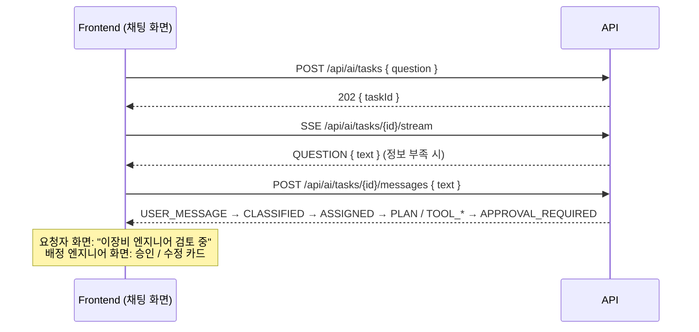
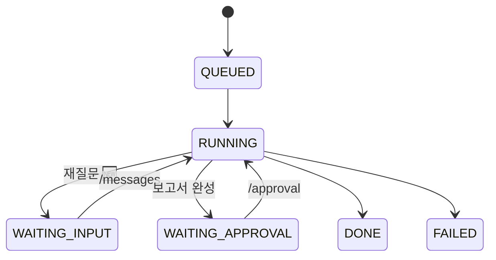

# REST API 명세

🆕 = 오늘 추가되는 항목 (대화형 요청 · 분류 · 담당자 배정). 나머지는 지금 서버에서 동작 중.

## 공통

| 항목 | 값 |
|---|---|
| Base URL | 서버 `http://32.236.188.208` · 로컬 `http://localhost:8000` |
| 형식 | JSON (UTF-8), 시각은 ISO 8601 |
| 인증 (목업) | 헤더 `X-User-Name`, `X-User-Role` — Supabase 도입 시 `Authorization: Bearer`로 교체 |
| 역할 | `worker` · `engineer` · `admin`. 엔지니어는 `engineers` 테이블에 등록된 이름만 🆕 |
| CORS 🆕 | 서버 `.env`의 `CORS_ORIGINS`(쉼표 구분)에 프론트 주소 등록 |

- 한글 이름은 헤더에 그대로 못 넣으므로 `encodeURIComponent(name)` 해서 보낸다.
- SSE(`EventSource`)는 헤더를 못 보내므로 쿼리 `?user_name=…&user_role=…` 로 보낸다.

### 접근 범위 🆕

| 역할 | 볼 수 있는 작업 (목록 · 상세 · SSE) | 승인 / 수정 요청 | 답변 (`/messages`) |
|---|---|---|---|
| `worker` | 본인이 요청한 것 | X | 본인 작업 |
| `engineer` | **본인에게 배정된 것** + 본인이 요청한 것 | **배정된 것만** | 본인이 요청한 작업 |
| `admin` | 전체 | X | X |

볼 수 없는 작업은 존재 여부를 숨기기 위해 **404**로 응답한다. 분류·배정 전에는 엔지니어에게 보이지 않는다.

### 오류

| 코드 | 의미 |
|---|---|
| 401 | 헤더 없음 / 잘못된 역할 |
| 403 | 역할 권한 없음 (예: 작업자가 승인), 미등록 엔지니어 |
| 404 | 없는 작업, 또는 볼 권한이 없는 작업 |
| 409 | 상태가 맞지 않음 (승인 대기가 아닌데 승인, 답변 대기가 아닌데 답변) |
| 422 | 요청 본문 검증 실패 |

응답 본문: `{ "detail": "메시지" }`

---

## 1. 대화형 조사 흐름 (프론트 구현 순서)



같은 SSE 스트림 하나로 대화(QUESTION ↔ USER_MESSAGE)와 진행 상황을 모두 받는다.

## 2. 조사 작업

### POST `/api/ai/tasks` — 조사 요청 (대화 시작)
권한: `worker`, `engineer`

```json
{ "question": "어제 01M01 장비가 FlowCool 압력 알람으로 섰어요. run 10825571-1132 봐주세요" }
```
| 필드 | 제약 |
|---|---|
| `question` | 2–1000자. 자유 문장 — 장비 · run · 증상을 여기서 추출한다 |
| `tool` | 선택 🆕 (예전 방식 호환. 주면 추출보다 우선) |
| `run_id` | 선택 🆕 |

응답 `202` `{ "taskId": "6f1c…-uuid" }`

장비·run을 못 찾으면 SSE로 `QUESTION`이 오고 상태가 `WAITING_INPUT`이 된다.

### POST `/api/ai/tasks/{taskId}/messages` 🆕 — 재질문에 답변
권한: 작업을 요청한 사람. 상태가 `WAITING_INPUT`일 때만 (아니면 409).

```json
{ "text": "run은 10825571-1132 입니다" }
```
응답 `202` `{ "taskId": "…" }`. 이어지는 결과는 SSE로 (`USER_MESSAGE` → … ).

### GET `/api/ai/tasks` — 목록
권한: 전체. 범위는 위 접근 범위 표. `?mine=true`면 누구든 본인이 요청한 것만.

응답 `200` (최신순, 최대 200)
```json
[{ "id": "…", "user_name": "김작업", "user_role": "worker", "question": "…", "tool": "01M01",
   "run_id": "10825571-1132", "status": "WAITING_APPROVAL", "category": "EQUIPMENT", "assignee": "이장비",
   "error": null, "created_at": "…", "updated_at": "…" }]
```
`category`, `assignee` 🆕. `tool`·`run_id`는 추출 전이면 `null`.

### GET `/api/ai/tasks/{taskId}` — 상세
권한: 접근 범위 표

응답 `200`
```json
{ "id": "…", "user_name": "…", "user_role": "…", "question": "…", "tool": "01M01", "run_id": "…",
  "status": "DONE", "category": "EQUIPMENT", "category_reason": "…", "assignee": "이장비",
  "report": { /* 아래 Report */ }, "error": null, "created_at": "…", "updated_at": "…",
  "investigation_id": 1, "approved_by": "이장비", "approved_at": "…" }
```
`investigation_id` 등은 승인 저장 전이면 `null`. `category`, `category_reason`, `assignee` 🆕

### GET `/api/ai/tasks/{taskId}/stream` — 진행 이벤트 (SSE)
권한: 쿼리 `user_name`, `user_role` + 접근 범위 표

```js
const es = new EventSource(`/api/ai/tasks/${id}/stream?user_name=${encodeURIComponent(name)}&user_role=${role}`)
es.addEventListener('QUESTION', e => showBotMessage(JSON.parse(e.data).text))
es.addEventListener('DONE', () => es.close())
```
- 처음 연결하면 지난 이벤트부터 전부 재생된다 (대화 기록 복원에 사용). 끊긴 뒤 재연결하면 `Last-Event-ID`부터 이어서 받는다 (EventSource 자동).
- `DONE`·`FAILED` 후 서버가 스트림을 닫는다. 30초마다 keep-alive 주석이 온다.
- 재배정되어 접근 권한을 잃은 엔지니어의 스트림은 `ASSIGNED` 이벤트 뒤 닫힌다 🆕.

### POST `/api/ai/tasks/{taskId}/approval` — 검토 결정
권한: **배정된 엔지니어** 🆕. 상태가 `WAITING_APPROVAL`일 때만 (아니면 409).

```json
{ "action": "approve" }
{ "action": "revise", "comment": "z < 3 항목은 '경미한 편차'로 표현" }
{ "action": "revise", "comment": "공정 쪽으로 다시 봐주세요", "category": "PROCESS" }
```
| 필드 | 값 |
|---|---|
| `action` | `approve` 저장 / `revise` 재작성 |
| `comment` | 0–1000자 |
| `category` 🆕 | 선택. `EQUIPMENT` · `PROCESS` · `UNCLEAR` — 주면 그 분기로 다시 조사하고 **해당 분야 엔지니어에게 재배정** |

응답 `202` `{ "taskId": "…" }` — 결과는 SSE로 온다.

---

## 3. SSE 이벤트

각 이벤트: `id: <seq>`, `event: <TYPE>`, `data: <JSON>` (모든 data에 `at` 시각 포함)

| TYPE | 언제 | data | 채팅 화면 표시 예 |
|---|---|---|---|
| `QUEUED` | 생성 | `{ by }` | — |
| `QUESTION` 🆕 | 정보 부족 | `{ text, missing: ["run_id"] }` | 봇 메시지 |
| `USER_MESSAGE` 🆕 | 답변 수신 | `{ by, text }` | 사용자 메시지 |
| `CLASSIFIED` 🆕 | 분류·재분류 | `{ category, confidence, reason, reroute, by }` — `by`: `agent` · `verify` · 엔지니어 이름 | "장비 이상으로 분류했어요" |
| `ASSIGNED` 🆕 | 배정·재배정 | `{ assignee, specialty, previous }` | "이장비 엔지니어에게 전달" |
| `PLAN` | 매 턴 | `{ turn, reason, next, branch🆕 }` | 진행 표시 |
| `TOOL_START` | 도구 시작 | `{ name, args }` | 진행 표시 |
| `TOOL_END` | 도구 끝 | `{ name, ms, ok, result }` | 근거 패널 |
| `TOKEN` | 보고서 작성 | `{ text }` (요약문) | 봇 메시지 |
| `APPROVAL_REQUIRED` | 승인 대기 | `{ report, revision, assignee🆕 }` | 엔지니어: 승인 카드 / 요청자: "검토 중" |
| `REVIEWED` | 엔지니어 결정 | `{ by, action, comment, category🆕 }` | 이력 |
| `DONE` | 종료 | `{ saved: { saved, investigation_id \| reason }, report }` | 결과 |
| `FAILED` | 오류 | `{ error }` | 오류 |

### 작업 상태 `status`



### Report

```json
{
  "category": "EQUIPMENT",
  "category_reason": "…",
  "assignee": "이장비",
  "summary": "한두 문장 요약 (원인 단정 없음)",
  "facts": ["도구 결과에서 나온 사실"],
  "evidence": ["문서명 > 섹션"],
  "next_actions": ["엔지니어가 확인할 것"],
  "unknowns": ["데이터로 알 수 없는 것"]
}
```
`category`, `category_reason`, `assignee` 🆕

---

## 4. 화면 보조

### GET `/api/engineers` 🆕 — 엔지니어 목록 (로그인 선택용)
권한: 없음
```json
[{ "name": "이장비", "specialty": "EQUIPMENT", "tools": ["01M01"] },
 { "name": "박공정", "specialty": "PROCESS", "tools": ["01M01"] }]
```

### GET `/api/runs?tool=01M01&q=1132` — run 검색
권한: 전체. 최신순 20개.
```json
[{ "run_id": "10825571-1132", "lot": "1132", "stage": "…", "recipe": "…", "minutes": 12.4 }]
```

### GET `/api/runs/near-faults` — 고장 직전 run (시연용 예시)
권한: 전체
```json
[{ "tool": "01M01", "run_id": "…", "recipe": "…", "fault_name": "Flowcool leak", "hours_before": 2.1 }]
```

### GET `/api/admin/overview` — 관리자 대시보드
권한: `admin`
```json
{
  "status": [{ "status": "DONE", "n": 3 }],
  "category": [{ "category": "EQUIPMENT", "n": 2 }],
  "engineers": [{ "name": "이장비", "specialty": "EQUIPMENT", "open": 1, "done": 4 }],
  "unassigned": [{ "id": "…", "question": "…", "category": "UNCLEAR" }],
  "investigations": [{ "id": 1, "tool": "…", "run_id": "…", "approved_by": "…", "approved_at": "…", "summary": "…" }],
  "docs": [{ "source": "investigation_guide.md", "chunks": 6, "embed_model": "text-embedding-3-small" }],
  "data": [{ "tool": "01M01", "runs": 11475, "faults": 19 }],
  "tool_calls": [{ "name": "compare_signals", "calls": 5, "avg_ms": 120, "errors": 0 }]
}
```
`category`, `engineers`, `unassigned` 🆕

### PATCH `/api/admin/tasks/{taskId}/assignee` 🆕 — 수동 배정
권한: `admin`. 미배정 작업 처리 또는 담당 변경.
```json
{ "assignee": "박공정" }
```
응답 `200` `{ "taskId": "…", "assignee": "박공정" }` + SSE `ASSIGNED { by: "admin" }`

## 빠른 확인 (curl)

```bash
curl -s -X POST http://32.236.188.208/api/ai/tasks \
  -H 'Content-Type: application/json' -H 'X-User-Name: kim' -H 'X-User-Role: worker' \
  -d '{"question":"01M01 FlowCool 압력 알람 후 정지, run 10825571-1132"}'
curl -N "http://32.236.188.208/api/ai/tasks/<taskId>/stream?user_name=kim&user_role=worker"
```
