# TRACE — 식각 공정 이상 조사 AI Agent 아키텍처

> 이상을 **판정**하지 않고, 이상 이후의 **조사**(조회·비교·근거 수집·보고서 초안)를 Agent가 수행하고 사람이 검토·승인한다.
> 기준 문서: 팀 기획서 `etch_trace_agent_brief.html`, Agent 그래프 설계 이미지, AI Agent Capstone(+MCP) 5장 레퍼런스 아키텍처·6장 Harness.

- 문서 버전: v0.2 (2026-10-19) — POC 구현 반영
- 상태 표기: ✅ 오늘 POC 구현 · 🔜 다음 단계 · 📐 설계만

---

## 1. 이해관계자와 역할

| 이해관계자 | 시스템 역할 | 목표 | 화면 | 할 수 있는 것 | 할 수 없는 것 |
|---|---|---|---|---|---|
| 설비 작업자 (Operator) | `worker` | 이상 징후를 빨리 넘기고 결과를 받는다 | `/worker` | 조사 요청, 내 요청 상태·승인된 결과 조회 | 다른 사람 요청 열람, 승인, 운영 지표 |
| 공정 엔지니어 (Process Engineer) | `engineer` | 근거를 보고 판단·승인 (HITL) | `/engineer/:id` | 전체 조사 열람, 실시간 진행 관찰, 수정 요청, **승인** | 운영 지표 |
| 관리자 (Admin / 품질·운영) | `admin` | 시스템이 믿을 만하게 돌아가는지 관리 | `/admin` | 전체 이력, 승인 기록, 문서 색인 현황, 도구 호출 지표, 실패 작업 | 조사 승인 (직무 분리) |
| LLM Provider (외부) | — | 다음 행동 제안, 보고서 문장 작성 | — | 도구 **제안** | 도구 실행, 수치 계산, 저장 |
| 데이터 제공자 (PHM Society) | — | 공개 데이터셋 | — | — | — |

권한은 **서버에서** 검사하고(`main.py` `user()`), 화면은 router guard로 역할별 홈만 보여준다(`router.js`).

---

## 2. 전체 구성도 (Container 관점) — PDF 그림 5-2 대응

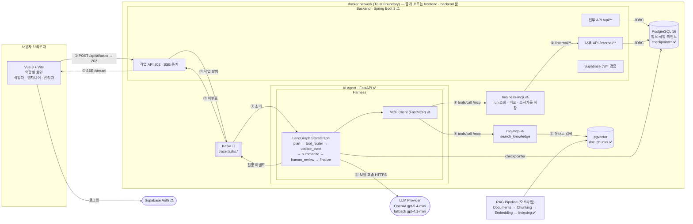

### 번호별 처리 (PDF 표 5-3 대응)

| # | 구간 | 처리 | 프로토콜 |
|---|---|---|---|
| ① | Vue → Spring Boot | `POST /api/ai/tasks`, 202 `{taskId}` 즉시 반환 | HTTPS |
| ② | Spring Boot → Agent | 작업 상태 저장 후 `trace.tasks.requested` 발행, Agent consumer가 실행 | Kafka (POC: 내부 HTTP/BackgroundTask) |
| ③ | LangGraph → LLM | Harness가 Instructions·Context를 붙여 모델 호출, 모델이 다음 도구 제안 | HTTPS |
| ④ | MCP Client → MCP Server | 제안된 도구 `tools/call`. 저장 도구는 승인 전까지 호출 불가 | MCP Streamable HTTP `/mcp` |
| ⑤ | business-mcp → Spring Boot | 업무 데이터는 `/internal/**` 경유 (업무 규칙 단일화) | 내부 HTTP |
| ⑥ | rag-mcp → pgvector | 질문 임베딩과 가까운 chunk + 출처 | SQL `<=>` |
| ⑦ | Agent → Spring Boot → Vue | `QUEUED·PLAN·TOOL_START·TOOL_END·TOKEN·APPROVAL_REQUIRED·REVIEWED·DONE·FAILED` | Kafka → SSE |

### 구성 요소별 목적·책임·금지 사항 (PDF 표 5-4)

| 구성 요소 | 역할 | 금지 사항 |
|---|---|---|
| Vue 3 | 요청 입력, 진행·근거·승인 화면 | 권한 판단, AI 서버 직접 호출(Spring 단계 이후) |
| Spring Boot | 업무 API, 작업 생성·상태, SSE 중계, `/internal/**`, 인증 | LLM 호출 |
| FastAPI Agent | Harness로 모델 감싸기, 도구 선택, 승인 대기·재개 | DB 직접 쓰기 (POC는 예외, MCP 분리 시 제거) |
| business-mcp | run 조회·비교·조사기록 저장 도구 노출 | 업무 규칙 복제 |
| rag-mcp | 문서 검색, 출처 반환 | 업무 데이터 변경 |
| PostgreSQL | 공정 데이터 요약, 작업·이벤트·조사기록, checkpointer | — |
| pgvector | 문서 chunk·임베딩·출처 메타데이터 | — |

---

## 3. 논리 아키텍처 (Layered) — PDF 그림 5-3

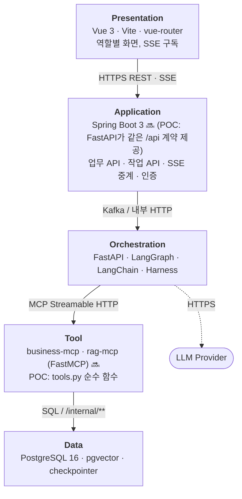

| Layer | 아래 layer와의 인터페이스 | 금지 |
|---|---|---|
| Presentation | `REST /api/**`, `SSE` | 권한 판단, AI 서버 직접 호출 |
| Application | Kafka 발행 / 내부 HTTP, JDBC | LLM 호출 |
| Orchestration | MCP `/mcp`, LLM API | DB 직접 쓰기 |
| Tool | business-mcp → `/internal/**`, rag-mcp → pgvector | 업무 규칙 복제 |
| Data | — | — |

> 예외: business-mcp → Application `/internal/**` 호출은 아래→위 호출이지만, 업무 규칙을 Spring Boot 한 곳에 두려는 **의도된 예외**이며 docker network 안에서만 열린다.

---

## 4. 런타임 뷰 — 시퀀스 다이어그램

### 4.1 동기 경로 vs 비동기 경로

| 경로 | 거치는 일 | 응답 |
|---|---|---|
| 동기 (수백 ms) | run 검색, 작업 목록·상태 조회, 승인·거절 기록, 관리자 지표 | 200 즉시 |
| 비동기 (수 초~수십 초) | Agent 조사, 보고서 재작성, 문서 재색인, 승인 후 재개 | 202 후 SSE 이벤트 |

### S1. 조사 요청 → 데이터 조회·비교 (Agent 루프)

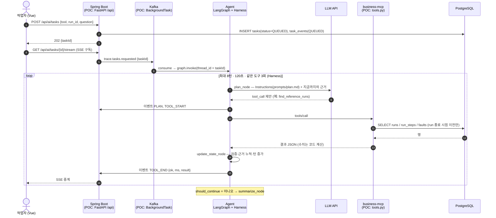

### S2. 문서 근거 검색 (RAG) — PDF 그림 5-6

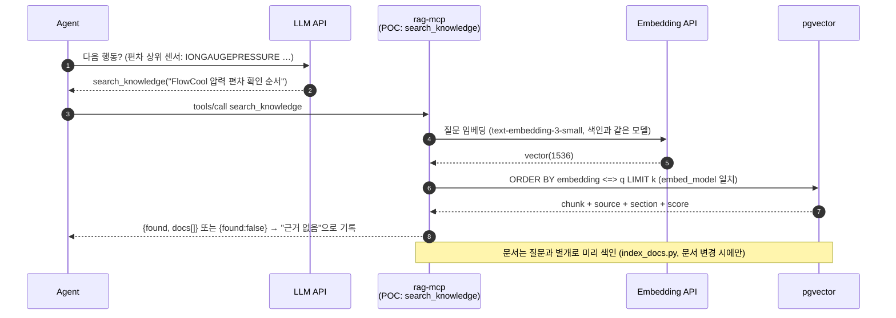

### S3. 보고서 → 사람 검토 → 수정 요청 → 승인 → 저장 (HITL) — PDF 그림 5-7

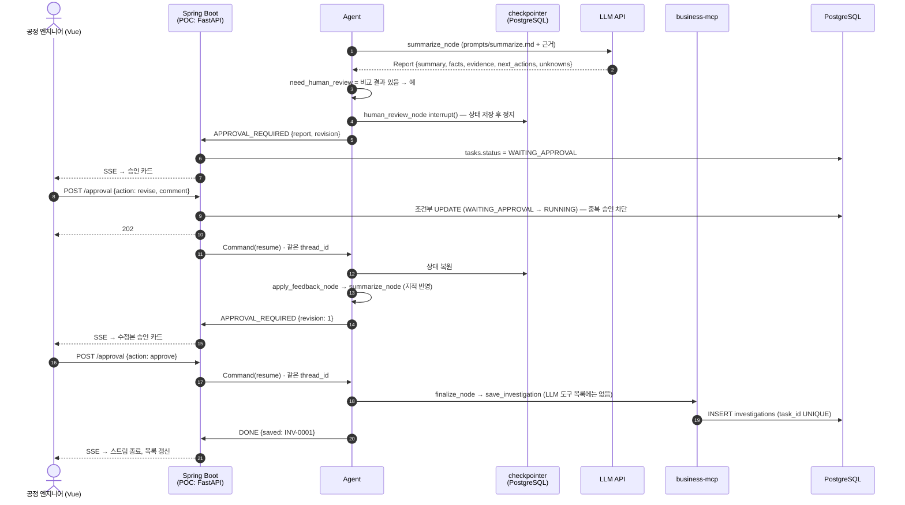

### S4. (📐 설계) Kafka 대기열 · 재시도 · DLQ — 평가 가산점 항목

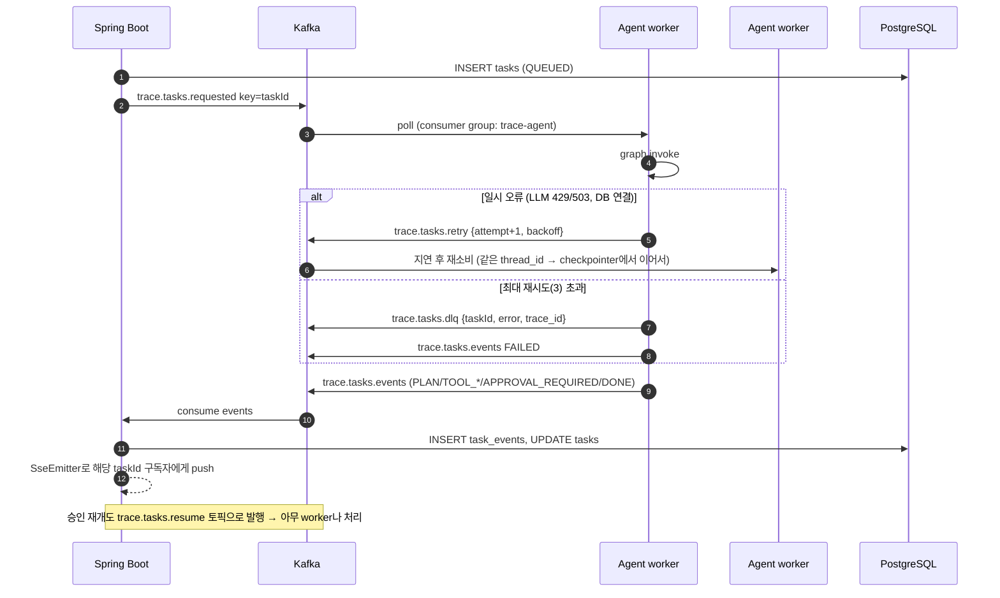

| 토픽 | key | 생산자 → 소비자 | 비고 |
|---|---|---|---|
| `trace.tasks.requested` | taskId | Spring → Agent | 파티션 key로 같은 작업 순서 보장 |
| `trace.tasks.resume` | taskId | Spring → Agent | 승인/수정 요청 `Command(resume)` |
| `trace.tasks.retry` | taskId | Agent → Agent | attempt, backoff(2s·8s·30s) |
| `trace.tasks.dlq` | taskId | Agent → 관리자 화면 | 실패 원인 + trace id |
| `trace.tasks.events` | taskId | Agent → Spring | 현 `task_events` 행과 1:1 (스키마 동일) |

멱등성: checkpointer가 thread_id 단위로 진행을 저장하고, `investigations.task_id UNIQUE` + 조건부 상태 UPDATE로 재처리해도 중복 저장되지 않는다.

### S5. 오늘 POC의 실제 경로 (생략된 것 표시)

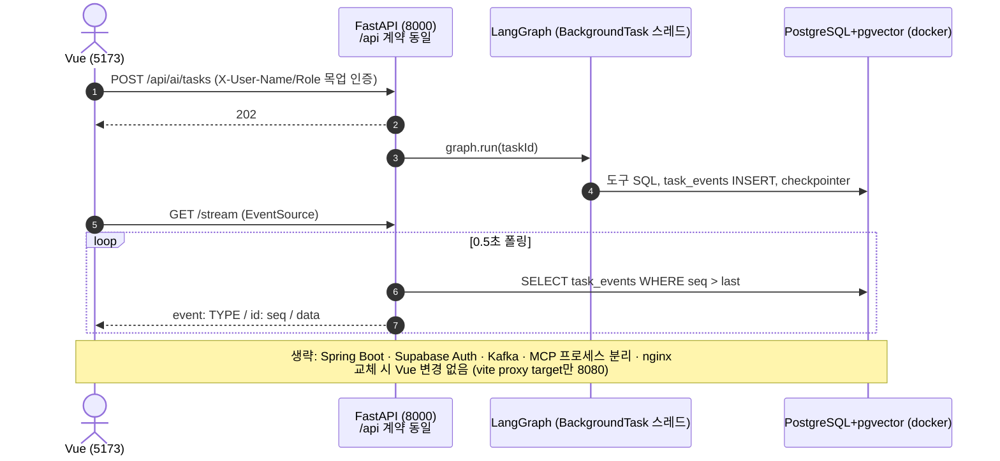

---

## 5. Agent 설계 — LangGraph StateGraph (설계 이미지와 1:1)

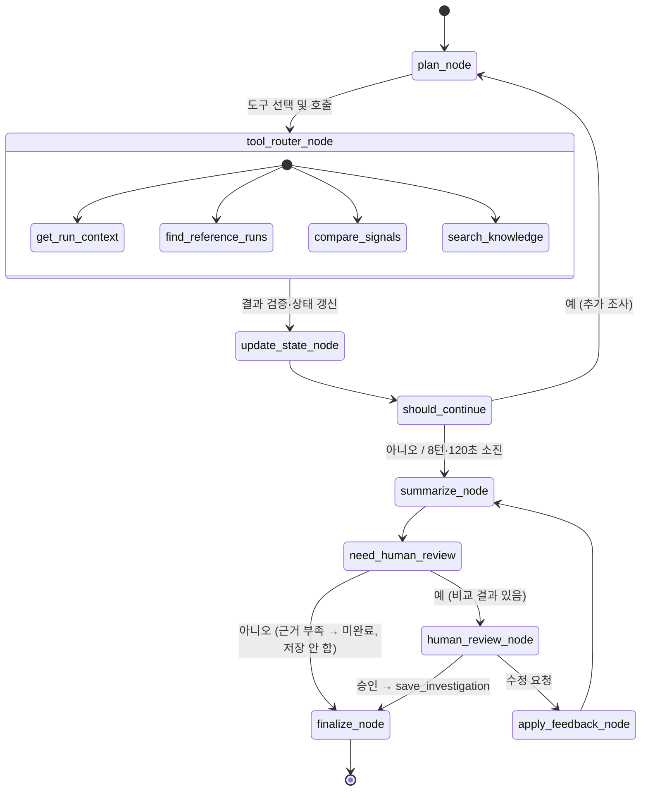

### State

| 필드 | 타입 | 설명 |
|---|---|---|
| `task_id` | str | = LangGraph `thread_id` = tasks.id |
| `question`, `tool`, `run_id` | str | 조사 요청과 대상 |
| `started_at`, `turns` | float, int | Harness 한도 판단 |
| `next_call` | dict \| None | plan이 고른 `{name, args, reason}`. None이면 조사 종료 |
| `last_result` | dict | router → update_state 전달 |
| `evidence` | list (append reducer) | `{name, args, result, ok}` 누적 근거 |
| `report` | dict | `summary, facts[], evidence[], next_actions[], unknowns[]` |
| `feedback` | list (append) | 엔지니어 수정 요청 누적 |
| `approval` | dict | `{action, comment, by}` (interrupt 재개값) |
| `saved` | dict | 저장 결과 `INV-xxxx` |

### 도구 (→ MCP Tool로 그대로 승격)

| 도구 | 위치(예정) | 입력 | 출력 | 주의 |
|---|---|---|---|---|
| `get_run_context` | business-mcp | tool, run_id | recipe·stage·steps·**run 종료 전** 고장 | 미래 정보 누설 차단 |
| `find_reference_runs` | business-mcp | tool, run_id, k | 같은 recipe 이전 run, 고장 직전 24h 제외 | 3건 미만이면 error |
| `compare_signals` | business-mcp | tool, run_id, reference_run_ids | step×센서 z-score, 결측률 차이 | 숫자는 코드만, 누적 카운터 제외 |
| `search_knowledge` | rag-mcp | query, k | chunk·출처·유사도 | 없으면 `found:false` |
| `save_investigation` | business-mcp (`destructiveHint`) | task_id, report, approved_by | INV id | **LLM 도구 목록에서 제외**, finalize에서만 |

---

## 6. Harness 8요소 ↔ 구현 위치 (PDF 표 6-3)

| 요소 | 구현 위치 | 기준 | 상태 |
|---|---|---|---|
| Instructions | `agent/prompts/plan.md`, `summarize.md` | 역할·도구 규칙·금지·출력 형식, 코드 밖 버전관리 | ✅ |
| Tools | `tools.py` `TOOLS` (→ MCP Client) | 결과 3,000자 제한, 오류는 결과로 반환 | ✅ |
| Context | `plan_node` 메시지 구성 | 이전 결과 1,200자 요약 주입, RAG 근거 주입 | ✅ (요약 압축 🔜) |
| State·Memory | `PostgresSaver` checkpointer | thread_id 단위 저장, 승인 대기 후 그대로 재개 | ✅ |
| Agent Loop | `should_continue` | 최대 8턴 · 120초 · 같은 도구 3회 | ✅ |
| Guardrails | `human_review_node` `interrupt()`, router 허용 목록 | 저장 도구는 승인 후에만, 역할 검사, 중복 승인 차단 | ✅ (PII 마스킹 해당 없음) |
| Recovery | `model()` `.with_fallbacks`, `_fallback_plan`, `_template_report` | 재시도 2회 → 대체 모델 → 고정 순서/템플릿 → FAILED | ✅ |
| Observability | `task_events`(단계·도구·ms·오류), 관리자 지표 | LangSmith trace id 연결 | ✅ / LangSmith 🔜 (env만 설정) |

---

## 7. 배포 뷰 (N-tier) — PDF 그림 5-9, 표 5-10

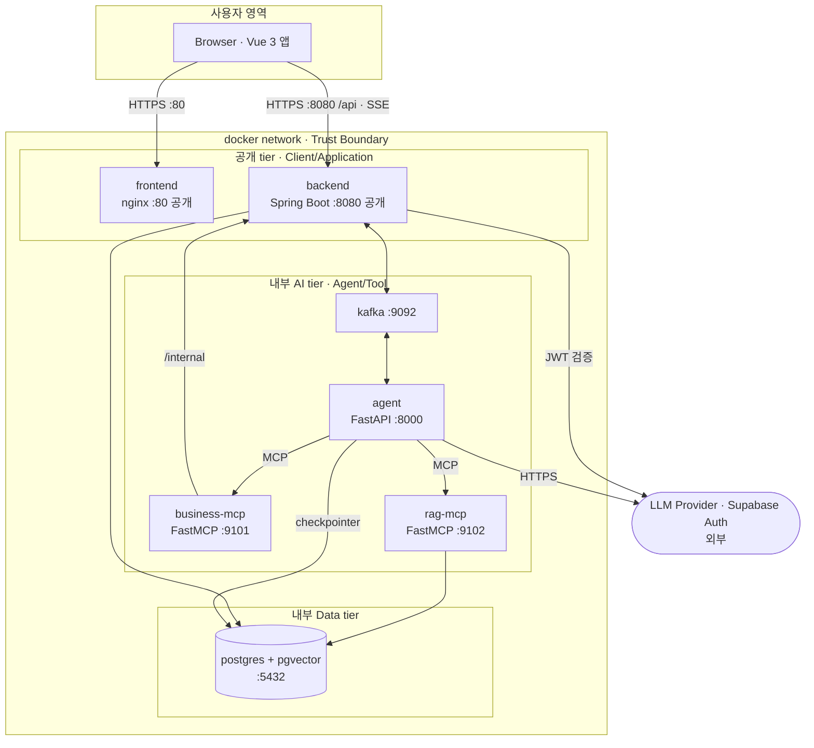

| 서비스 | 기술 | 포트 | 공개 | 먼저 떠 있어야 | 오늘 |
|---|---|---|---|---|---|
| frontend | Vue 3 + nginx | 80 (dev 5173) | 공개 | backend | ✅ dev |
| backend | Spring Boot 3 | 8080 | 공개 | postgres, kafka | 🔜 |
| agent | FastAPI + LangGraph | 8000 | 내부 | kafka, MCP | ✅ (공개 상태로 대체) |
| business-mcp | FastMCP | 9101 | 내부 | backend | 🔜 |
| rag-mcp | FastMCP | 9102 | 내부 | postgres | 🔜 |
| kafka | Kafka (KRaft) | 9092 | 내부 | — | 📐 |
| postgres | `pgvector/pgvector:pg16` | 5432 | 내부 | — | ✅ |

---

## 8. 데이터 설계

### 8.1 원본 데이터: PHM Society 2018 Data Challenge (이온 밀 식각)

- 장비 20대(train) × 장비당 1~1.9GB CSV, 압축 5.0GB / 해제 약 35GB. **오늘 적재: 01M01 1대** (311만 행, 460일)
- 컬럼: `time, Tool, stage, Lot, runnum, recipe, recipe_step` + 센서 17개 (IONGAUGEPRESSURE, ETCHBEAM*, ETCHSUPPRESSOR*, FLOWCOOLFLOWRATE, FLOWCOOLPRESSURE, …)
- 고장 3종: FlowCool Pressure Dropped Below Limit / Flowcool Pressure Too High Check Flowcool Pump / Flowcool leak (01M01: 13 / 5 / 1건)

**데이터를 열어보고 바뀐 설계 결정**

| 기획 단계 가정 | 실제 데이터 | 결정 |
|---|---|---|
| run = runnum | runnum 안에 Lot 여러 개, recipe 여러 개 (3,757/3,776) | 조사 단위 `run_id = '{runnum}-{Lot}'` → 11,475개, 모두 recipe 1개 |
| Lot = 웨이퍼 1회 처리 | 같은 Lot이 다른 stage에서 재처리 (2,690건) | Lot 단독 키 사용 안 함 |
| 센서 원값·단위 | 이미 **표준화된 값**, 단위 없음 | 보고서에 단위 금지, "표준화 값" 명시 |
| 고장 시각 = 고장 시작 | 운영자 정지 시각 | 근거·unknowns에 명시, 참조 run에서 고장 직전 24h 제외 |
| 누적 카운터도 신호 | ETCHSOURCEUSAGE 등은 단조 증가 | 편차 비교에서 제외 |

### 8.2 ERD

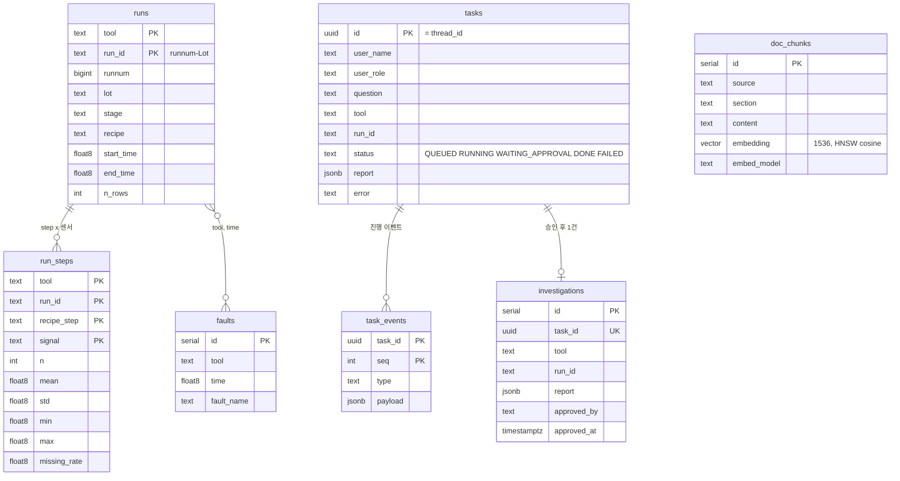

### 8.3 RAG 문서 색인 (Pipe and Filter)

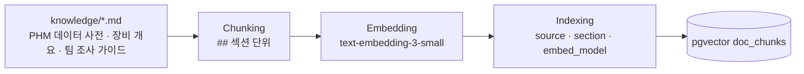

---

## 9. API · 이벤트 계약 (PDF 표 5-8, 5-9)

| Method | Path | 역할 | 응답 |
|---|---|---|---|
| POST | `/api/ai/tasks` | worker, engineer | 202 `{taskId}` |
| GET | `/api/ai/tasks/{id}` | 전체 (worker는 본인 것만) | task + 승인 정보 |
| GET | `/api/ai/tasks/{id}/stream` | 전체 | `text/event-stream`, `Last-Event-ID` 재연결 지원 |
| POST | `/api/ai/tasks/{id}/approval` | **engineer만** | 202, 대기 상태 아니면 409 |
| GET | `/api/ai/tasks?mine=true` | 전체 | 목록 |
| GET | `/api/runs`, `/api/runs/near-faults` | 전체 | run 검색 (→ Spring 업무 API로 이관) |
| GET | `/api/admin/overview` | **admin만** | 상태 집계·승인 기록·문서·도구 지표 |

| 이벤트 | 시점 | 화면 |
|---|---|---|
| `QUEUED` | 접수 | 타임라인 |
| `PLAN` | plan_node가 다음 행동 결정 | 타임라인 (Agent 판단 이유) |
| `TOOL_START` / `TOOL_END` | 도구 실행 전후 (ms, ok, 결과) | 타임라인 + 근거 패널 |
| `TOKEN` | 보고서 요약 생성 | 타임라인 |
| `APPROVAL_REQUIRED` | interrupt로 정지 | 승인 카드 + 보고서 |
| `REVIEWED` | 승인/수정 요청 기록 | 타임라인 |
| `DONE` / `FAILED` | 종료 | 스트림 종료, 목록 갱신 |

---

## 10. 품질 속성 (ISO/IEC 25010) ↔ 설계 결정

| 품질 특성 | 설계 결정 |
|---|---|
| 기능 적합성 | 수치는 코드 계산, 보고서 수치는 도구 결과에서만 → 정합성 검사 가능 |
| 성능 효율성 | 원시 311만 행 → step×센서 통계 121만 행 사전 집계, 도구 응답 수 ms~수십 ms |
| 호환성 | `/api` 계약 고정 → FastAPI에서 Spring Boot로 바꿔도 Vue 변경 없음, 도구 → MCP 승격 |
| 사용성 | 역할별 화면, 실시간 진행, 근거 표·출처 함께 표시 |
| 신뢰성 | checkpointer 재개, 재시도·대체 모델·폴백, (Kafka) 재시도·DLQ |
| 보안 | 서버 측 역할 검사, 승인 전 저장 차단, 내부 서비스 비공개, 키는 `.env` |
| 유지보수성 | 프롬프트 코드 밖, 도구는 순수 함수, 계층별 금지 사항 |
| 이식성 | docker compose 서비스 단위 배포 |

---

## 11. 로드맵

| 단계 | 내용 | 완료 기준 |
|---|---|---|
| ✅ 0. POC (오늘) | 실데이터 01M01 적재, LangGraph Agent, RAG, HITL, SSE, 역할별 Vue | `e2e_check.py` 통과 |
| 🔜 1. MCP 분리 | `tools.py` → business-mcp(:9101) / rag-mcp(:9102), Agent에 FastMCP Client | Agent가 `list_tools`로 도구 발견 |
| 🔜 2. Spring Boot + Supabase | `/api/**` 이관, `/internal/**`, JWT 검증·역할 claim, SSE 중계 | Vue proxy target 8080 |
| 📐 3. Kafka | requested/resume/retry/dlq/events 토픽, worker 수평 확장 | 장애 시연 스크립트로 재시도·DLQ 확인 |
| 📐 4. 확장·평가 | 장비 20대 적재, LangSmith, 평가셋(조회 정확성·수치 정합성·승인 흐름) | 평가표 결과 비교 |
