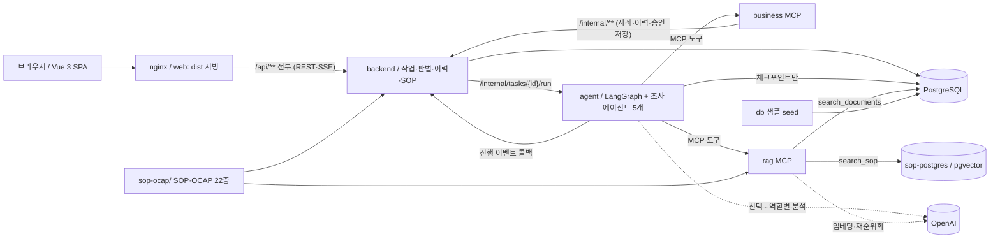

# TRACE v1.0.0 아키텍처

## 구성과 책임

| 구성 | 책임 | 경계 |
|---|---|---|
| frontend | Vue 3 + TypeScript SPA. 질문·재질문·채팅 판별·조사 기록·SOP 화면·실시간 진행 표시 ([frontend.md](frontend.md)) | 동일 출처 `/api`만 호출, AI 서버·MCP 직접 호출 없음 |
| nginx | 빌드 결과(`dist`) 서빙, `/api`와 SSE를 backend로 프록시 | 유일한 호스트 공개 포트 |
| backend | 신원·권한, 작업·메시지·검토·이벤트·승인 스냅샷, 승인 이력·SOP 문서 조회 API | 그래프를 직접 실행하지 않고 agent HTTP 호출, LLM 호출 없음 |
| agent | 접수·재질문, 조사 에이전트 5개(범위·Run 비교·센서·정비·추천), 보고서, 검토 interrupt/resume | 업무 DB 직접 조회 없이 MCP 사용 |
| business MCP | 사례 조회·결정론적 통계·승인 이력 조회·승인 저장 도구(에이전트 전용) | backend `/internal/**`만 호출, DB 직접 접속·공개 HTTP 경로 없음 |
| rag MCP | 문서 ID 조회(`search_documents`), SOP·OCAP 의미 검색(`search_sop`) | `etch_documents` 조회, `sop-ocap/` 색인을 sop-postgres에 저장 |
| PostgreSQL | 샘플 근거·backend 이력·agent 체크포인트 | 각 서비스가 소유한 영역 구분 |
| sop-postgres | SOP·OCAP 절 단위 임베딩(pgvector) | rag MCP 전용 |

서비스 간 전체 경로(공개·내부 API, MCP 도구, 파일·데이터 경로)는 [structure-review.md](structure-review.md)의 경로 지도에 정리했다.

## 요청부터 승인까지

1. 브라우저가 목업 신원 헤더와 `{question}`을 backend에 보낸다. backend는 작업·첫 메시지·QUEUED 이벤트를 저장하고 202 `{taskId}`를 반환한다.
2. backend가 RUNNING으로 변경하고 내부 HTTP로 agent를 실행한다. 조사 범위나 증상이 부족하면 agent가 QUESTION을 보내고 PostgreSQL 체크포인트에서 대기한다.
3. 요청자만 `/messages`에 답변할 수 있다. backend는 메시지·이벤트를 남기고 동일 task/thread를 재개한다.
4. agent가 business MCP로 사례·통계를, rag MCP로 조항을 읽고 보고서를 구성한다. 근거 부족은 INCOMPLETE다.
5. APPROVAL_REQUIRED가 오면 backend는 report를 저장하고 WAITING_APPROVAL로 바꾼다. engineer만 수정·승인을 접수할 수 있다.
6. 수정은 feedback을 누적하고 기존 근거를 유지한 보고서로 다시 대기한다(조사 에이전트는 다시 실행하지 않는다). 승인은 검토 당시 스냅샷을 보존하며 DONE 콜백에서 승인 이력을 저장한다.

실행 중 예외·HTTP 전달 실패는 FAILED로 보인다. backend 재시작 시 대기 상태는 보존하지만 중단된 QUEUED/RUNNING은 FAILED가 된다. 저장된 이력과 체크포인트가 있다고 실행 중 작업의 자동 복구를 보장하지 않는다.

backend와 agent 실행·이벤트 콜백은 내부 공유 키로 보호한다. 실행과 콜백에 동일 `X-Command-ID`를 전달해 이전 명령의 지연 결과가 새 명령을 완료시키지 못하도록 한다. [내부 API](api.md#내부-http-경계)를 참고한다.

## 접근과 이력

HTTP의 `X-User-Name`(URL 인코딩), `X-User-Role`은 필수 개발 목업 신원이다. worker는 자기 작업, engineer/admin은 전체 작업을 읽는다. 답변은 본인 작업에만, 검토는 engineer에만 허용한다. 담당자 자동 배정이나 검증된 외부 인증은 없다. Keycloak은 미래 범위다.

backend의 `v1_tasks`, `v1_messages`, `v1_events`, `v1_reviews`, `v1_investigations`가 작업·대화·진행·검토·승인 스냅샷의 기준이다. 승인 전에도 초안과 대화를 저장한다. 승인 스냅샷은 현장 원인 확정이 아니라 검토한 가설의 기록이다.

SSE와 이벤트 조회는 작업별 증가하는 `seq`로 재생한다. 브라우저가 상세를 복원하고 마지막 커서 이후를 받아 중복 제거한다. 종료 상태는 DONE/INCOMPLETE/FAILED다. 이전 localStorage 기록은 **로컬 읽기 전용**이며 서버 이력으로 자동 이관하지 않는다. 범위 조사 에이전트는 요청자에게 보이는 유사 승인 이력 최대 3건을 참고 근거로 쓴다(원인 확정이 아니다). 화면의 승인 이력 조회(`/api/ai/investigations`)는 backend가 직접 응답한다.

## 데이터

- `db/cases.json`, `db/documents.json`은 시연용 샘플이며 PHM 실측 데이터가 아니다.
- seed는 샘플을 upsert한다. 사례·문서의 demo/source 표시와 조항 ID를 보존한다.
- 통계는 코드로 계산하며 `sec`, `nm/min`, `W`, `mTorr` 등 샘플에 선언된 단위와 근거 사례 ID를 유지한다.
- RAG MCP의 `search_documents`는 정확한 문서 ID를 조회한다. `search_sop`는 `sop-ocap/`의 SOP·OCAP 문서를 절 단위로 임베딩해 sop-postgres에 색인하고 질문과 가까운 조항 3개를 재순위화해 반환한다(`OPENAI_API_KEY` 필요, 첫 호출 때 색인).
- SOP 화면은 backend가 같은 `sop-ocap/` 문서의 머리 표(담당 팀·버전·최근 개정)와 원문을 읽어 제공한다.
- 이전 PHM 적재·색인·구형 backend 그래프와 점검 스크립트는 제거했다. 이전 구현은 Git 이력에서 확인한다.

## Compose와 이동

`compose.yaml`이 postgres, sop-postgres, seed, backend, business-mcp, rag-mcp, agent, web을 정의한다. web은 `frontend/Dockerfile`로 Vite 빌드 결과를 담고, `sop-ocap/`은 backend와 rag-mcp에 읽기 전용으로 마운트한다. PostgreSQL healthcheck 뒤 seed 완료를 기다려 서비스를 시작한다. 공개 포트는 web만 가지며 `.env.example`의 `WEB_PORT=18080`으로 기존 POC와 포트를 분리한다. DB 비밀번호와 내부 공유 키도 `.env`에서 지정한다.

`docker-compose.yml`, `docker-compose.prod.yml`은 Compose 2.20.3 이상용 `include: [compose.yaml]` 호환 진입점이다. 별도 서비스·포트·볼륨을 덧붙이지 않는다. 권장 명령은 `docker compose -f compose.yaml up -d --build`다. include wrapper와 원본을 여러 `-f`로 중복 병합하지 않는다.

v1 볼륨은 `v1_pgdata`다. 예전 `pgdata`를 자동 변환하거나 삭제하지 않는다. 기존 POC와 병행할 때는 Compose 프로젝트 이름도 분리하여 서비스 교체를 피한다. 로컬 DB만 시작하던 예전 `.yml` 명령도 이제 전체 v1을 시작하므로 DB만 필요하면 `docker compose -f compose.yaml up -d postgres`를 사용한다. `.prod.yml`은 별도 보안·운영 설정을 제공하지 않는다.

전체 서비스 실행·권한·재시작·SSE의 성공은 별도 검증이 필요하다. 문서와 구성 정리만으로 테스트 통과를 주장하지 않는다.
