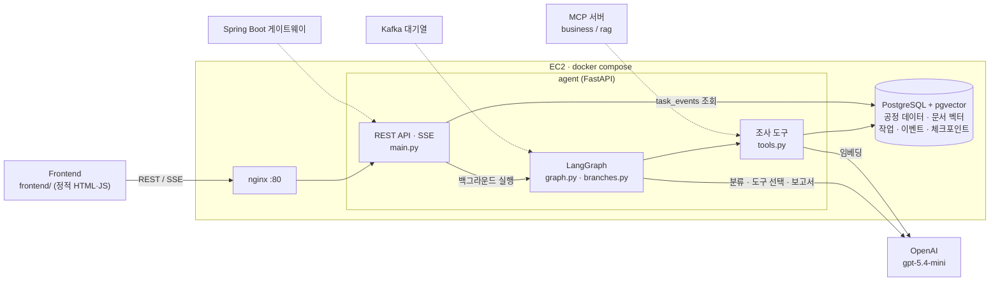
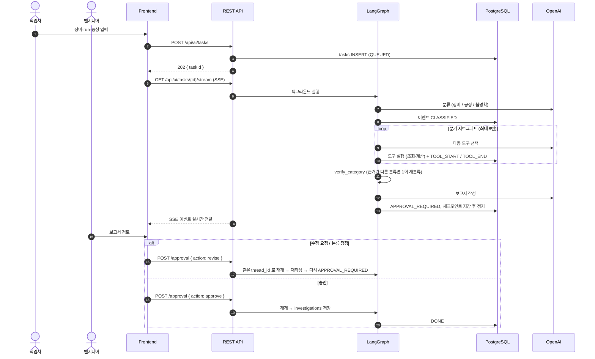
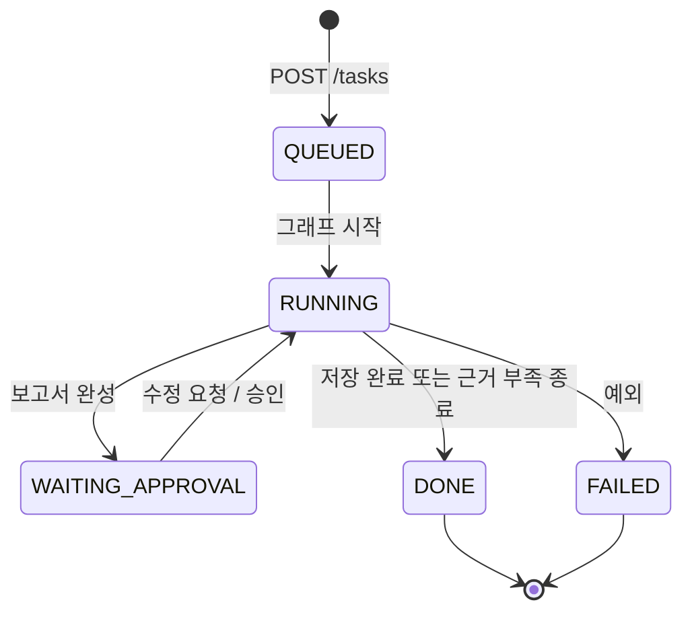

# 시스템 아키텍처

## 1. 역할

| 역할 | 하는 일 |
|---|---|
| 작업자 `worker` | 이상 현상 입력 → 조사 요청, 내 요청 결과 확인 |
| 공정 엔지니어 `engineer` | 진행 관찰, 보고서·분류 검토 → 승인 / 수정 요청 (Human-in-the-loop) |
| 관리자 `admin` | 전체 조사 이력, 분류 비율, 도구 호출 지표, 색인 문서 |

## 2. 구성도

실선은 오늘 구현, 점선은 다음 단계.

| 구성 요소 | 책임 | 하지 않는 것 |
|---|---|---|
| Frontend | 화면, 역할별 라우팅 | DB 직접 접근, 판정 로직 |
| nginx | 단일 공개 포트, SSE 프록시 | 비즈니스 로직 |
| REST API | 인증(목업 헤더), 권한, 작업 생성, 이벤트 스트림 | 조사 로직 |
| LangGraph | 분류 → 분기 조사 → 보고서 → 승인 대기 | 수치 계산 |
| 조사 도구 | SQL 조회, 통계(z-score, 추세) 계산 | 문장 생성 |
| PostgreSQL | 데이터·벡터·작업 상태·그래프 체크포인트 | — |

## 3. 요청 흐름

## 4. 작업 상태

## 5. 배포

| 서비스 | 포트 | 외부 공개 |
|---|---|---|
| nginx | 80 | O (보안그룹 HTTP 80) |
| agent | 8000 | X (docker network 내부) |
| postgres | 5432 | X |

## 6. 데이터 (PHM 2018 이온 밀 식각)

- 조사 단위 `run_id = {runnum}-{Lot}` (run 하나 = 레시피 하나). 현재 장비 `01M01` 적재: run 11,475 / 고장 19.
- 센서값은 표준화되어 **단위 없음**. 고장 시각은 정비 **정지 시각**(발생 시각 아님).
- 고장 3종이 모두 FlowCool 계열 → 장비 이상 분기의 정답 사례로 쓸 수 있음.
- 장비가 1대뿐이라 "같은 레시피를 다른 장비에서 돌려도 이상한가" 비교는 장비 추가 적재 후 가능.
