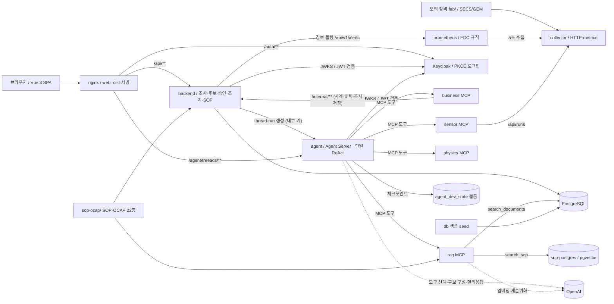

# TRACE v1.0.0 아키텍처

## 구성과 책임

| 구성 | 책임 | 경계 |
|---|---|---|
| frontend | Vue 3 + TypeScript SPA. 이상 로그 → 조사 제안서·채팅 → 원인 후보 → 조치 검토 → 조치 기록, 조사 기록, SOP·OCAP ([frontend.md](frontend.md)) | 동일 출처 `/api`, `/agent`만 호출. MCP 직접 호출 없음 |
| nginx | `dist` 서빙, `/api/`는 backend, 허용된 `/agent/threads` 경로는 Agent Server, `/auth/`는 Keycloak으로 프록시 | 유일한 호스트 공개 포트. `/agent/`에서 내부 키·Studio 헤더 제거 |
| Keycloak | Authorization Code + PKCE, 계정·로그인·갱신·로그아웃, `trace` 로그인 테마 | 개발용 `keycloak_data` 볼륨; 가입 없음 |
| backend | 신원 검증, 업무 조사·현재 후보·승인 사본·조치 기록, Prometheus 경보 묶음과 Agent Server 전달, SOP 화면 API, 레거시 `/api/ai/*` | LLM 호출 없음. 그래프를 실행하지 않고 thread·run 생성만 요청 |
| agent | 표준 Agent Server(`langgraph dev`), `prepare → agent ↔ tools → reason → publish` 단일 ReAct 그래프 ([agent.md](agent.md)) | 업무 DB 직접 조회 없이 MCP 사용. 모델에는 조회 도구만 바인딩 |
| business MCP | 사례 검색·통계, 승인 이력 조회, live 조사 저장·조회(`upsert_live_investigation`은 publish 노드 전용) | backend `/internal/**`만 호출, DB 직접 접속 없음 |
| rag MCP | 문서 ID 조회(`search_documents`), SOP·OCAP 의미 검색(`search_sop`, 후보 20개 → LLM 재순위화 3개) | `etch_documents` 조회, `sop-ocap/` 색인을 sop-postgres에 저장 |
| physics MCP | 식각 깊이·속도·선택비, 정상 Run 비교, R(t) 적분, 계측 Spec 비교, 교육용 Level 2/3 시뮬레이션 ([physics.md](physics.md)) | 외부 DB·LLM 없음, 누락값을 추정하지 않음 |
| sensor MCP | 정확한 장비·챔버·Lot·Wafer·Recipe 식별자로 Mock Fab Run 시계열 조회·분석 | collector 읽기 전용. 교육용 시뮬레이션은 사용자가 요청한 경우에만 결합 |
| prometheus | collector 수집(5초)과 `backend/prometheus/rules.yml` FDC 규칙 판정 | 호스트 포트 없음, 수집 대상은 `targets.json` |
| PostgreSQL | 샘플 근거, 업무 조사(`v1_live_investigations`), 레거시 v1 작업·이력 | 각 서비스가 소유한 영역 구분 |
| sop-postgres | SOP·OCAP 절 단위 임베딩(pgvector) | rag MCP 전용 |

서비스 간 전체 경로(공개·내부 API, MCP 도구, 파일·데이터 경로)는 [structure-review.md](structure-review.md)의 경로 지도에 정리했다.

## 경보부터 조치 기록까지

1. 모의 장비가 SECS/GEM으로 센서 값을 내고, collector가 이를 `/metrics`로 노출한다. Prometheus가 5초마다 수집해 FDC 규칙과 장비 알람을 판정한다.
2. backend가 `PROMETHEUS_URL`의 firing 경보를 (장비, 챔버, Lot) 단위로 묶고, 묶음을 닫으면 센서 구간을 붙인 고정 형식 텍스트를 만든다([agent-request.md](agent-request.md)).
3. backend가 내부 키로 Agent Server에 thread를 만들고 `{"request":{"role":"system","content":…}}`로 run을 시작한다. thread UUID가 곧 조사 ID다.
4. Agent가 경보를 파싱한 뒤 ReAct 순환으로 Business·RAG·Physics·Sensor 도구를 골라 근거를 모으고, 구조화 출력으로 원인 후보를 만든다. `publish` 노드가 Business MCP로 backend에 조사를 저장한다. 첫 저장 후에야 목록에 나타난다.
5. 로그인한 엔지니어가 제안서와 후보 근거를 보고 같은 thread에서 질문한다. 후보가 바뀌면 같은 조사의 revision이 오르고, 바뀌지 않으면 대화로만 답한다.
6. 엔지니어가 후보를 선택(승인)하면 backend가 검증된 사용자와 후보 사본을 저장한다. 조치 기록 전에는 선택을 취소하고 다시 고를 수 있다.
7. 실제 조치 내용과 확인 결과를 한 번 기록하면 조사가 조치 완료가 되고 조사 기록에서 다시 열린다.

동일 경보의 중복 방지는 backend 프로세스 메모리에만 있다. backend가 재시작되면 같은 경보로 새 조사가 생길 수 있고, Agent Server 전달 실패는 재시도하지 않는다.

## 접근과 저장

공개 REST와 Agent Server 대화 경로는 Keycloak Bearer access token을 검증한다. 서명·issuer·audience(`trace-api`)·만료·subject가 유효한 사용자는 모두 조회·대화·승인·조치 기록을 할 수 있다. 소유자·역할별 제한은 후속 범위다. 토큰은 브라우저 메모리에만 둔다. 경보 전달처럼 서버 간 요청은 내부 키(`X-Internal-Key`)를 쓴다.

업무 조사·현재 후보·승인 사본·조치 기록은 backend PostgreSQL에, 대화 체크포인트는 Agent Server의 `agent_dev_state` 볼륨에 있다. 두 저장소는 함께 보존해야 한다. 승인 사본은 현장 원인 확정이 아니라 검토한 가설의 기록이다.

레거시 `/api/ai/*` 작업·이벤트·승인 이력 테이블(`v1_tasks` 등)은 호환용으로 남아 있다. 이전 task 실행 agent는 제거되었으므로 새 작업 실행 경로로 쓰지 않는다([api.md](api.md#레거시-v1-작업-api)).

## 데이터

- `db/cases.json`, `db/documents.json`은 시연용 샘플이며 PHM 실측 데이터가 아니다. seed가 upsert하며 demo/source 표시와 조항 ID를 보존한다.
- 모의 장비 값은 100% 합성 데이터다([mock-fab.md](mock-fab.md)). 실제 생산 장비 시계열이 아니다.
- 통계·물리 수치는 코드로 계산하며 단위와 근거 사례·문서 ID를 유지한다.
- `search_sop`는 `sop-ocap/` 문서를 절 단위로 임베딩해 sop-postgres에 색인하고, 질문과 가까운 후보 20개를 LLM으로 재순위화해 조항 3개를 반환한다(`OPENAI_API_KEY` 필요).
- SOP 화면은 backend가 같은 `sop-ocap/` 문서의 머리 표(담당 팀·버전·최근 개정)와 원문을 읽어 제공한다.

## Compose와 배포

`compose.yaml`이 keycloak, postgres, sop-postgres, seed, backend, business-mcp, rag-mcp, physics-mcp, sensor-mcp, agent, web, prometheus를 정의한다. 모의 장비는 별도 호스트에서 `fab/compose.yaml`로 실행한다. 공개 포트는 web(`WEB_PORT`, 예시 18080)이며, Agent Server Studio 포트(`AGENT_SERVER_PORT`)는 localhost에만 공개한다. [Keycloak URL·계정·영속성](../deploy/keycloak/README.md)을 참고한다.

PR 단계에서는 GitHub Actions(`.github/workflows/ci.yml`)가 프런트 빌드와 Python 문법을 검사한다. develop 병합 후에는 Jenkins(EC2)가 설정 생성·DB 백업·빌드·교체·상태 확인을 수행한다([deploy.md](deploy.md)).

`docker-compose.yml`, `docker-compose.prod.yml`은 Compose 2.20.3 이상용 `include: [compose.yaml]` 호환 진입점이다. 권장 명령은 `docker compose -f compose.yaml up -d --build`다. include wrapper와 원본을 여러 `-f`로 중복 병합하지 않는다. v1 볼륨은 `v1_pgdata`이며 예전 `pgdata`를 자동 변환하거나 삭제하지 않는다.

전체 서비스 실행·권한·재시작의 성공은 별도 검증이 필요하다. 문서와 구성 정리만으로 테스트 통과를 주장하지 않는다.
